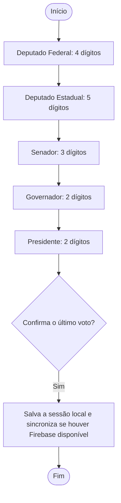

<div align="center">

# 🗳️ Urna Cidadã

**Simulador educativo de votação em Java, com ações sobre cidadania digital e desinformação eleitoral.**


</div>

> ⚠️ **Aviso:** este é um projeto **educativo**, não é um sistema eleitoral oficial e não tem relação com a Justiça Eleitoral. Candidatos, partidos, números e propostas são fictícios.

## 📑 Sumário

- [Sobre](#-sobre)
- [Situação do projeto](#-situação-do-projeto)
- [Como executar](#️-como-executar)
- [Como a votação funciona](#️-como-a-votação-funciona)
- [Testes](#-testes)
- [Estrutura](#-estrutura)
- [Documentação](#-documentação)
- [Privacidade e segurança](#-privacidade-e-segurança)
- [Limitações conhecidas](#️-limitações-conhecidas)
- [Resultados da ação de extensão](#-resultados-da-ação-de-extensão)
- [Como contribuir](#-como-contribuir)
- [Equipe](#-equipe)

## 🎯 Sobre

Projeto educativo de **Programação Orientada a Objetos**. Reúne duas frentes:

1. **O software:** uma urna de demonstração em Java 17 e Swing, com votação em cinco cargos e gravação local primeiro; quando configurado e conectado, sincroniza as sessões com o Cloud Firestore.
2. **A ação educativa:** uma oficina para conversar sobre cidadania digital, uso responsável da internet e identificação de desinformação eleitoral.

## 🚧 Situação do projeto

**A aplicação está pronta para demonstração.** A oficina e a avaliação de impacto ainda serão realizadas.

| Parte | Situação |
|---|---|
| Votação em cinco cargos, com voto válido, branco, nulo, legenda e correção | ✅ Implementada e coberta por testes automáticos |
| Interface Swing sem painel lateral, com teclado na tela e atalhos de teclado | ✅ Implementada; a captura do usuário mostra a urna em execução no Windows |
| Gravação local e fila para sincronização | ✅ Implementada; casos offline→online cobertos por testes automatizados com servidor HTTP local falso |
| Conexão com o Cloud Firestore | ✅ Configurada no computador do usuário; a tela mostrou “Online · tudo enviado” e o usuário informou que uma sessão de teste foi salva |
| Documentação técnica e de operação | ✅ Disponível em `docs/` |
| Material educativo e questionário de impacto | 📝 Modelos disponíveis; serão usados na oficina |
| Oficina com estudantes | ⬜ A realizar |
| Resultados e avaliação de impacto | ⬜ Depois da oficina |

## ▶️ Como executar

**Requisito:** JDK 17 ou superior, com `java`, `javac` e `jar` disponíveis no terminal. Maven não é necessário.

### Início rápido no Windows

Na pasta do projeto, dê duplo clique em `demo.bat` para abrir uma demonstração em memória. Para iniciar no modo padrão, que grava localmente primeiro e tenta sincronizar com o Firestore quando configurado, dê duplo clique em `iniciar.bat`.

Também é possível executar pelo terminal:

```bat
scripts\demo.bat
scripts\iniciar.bat
scripts\iniciar.bat --local
scripts\iniciar.bat --memoria
scripts\iniciar.bat --ajuda
```

O modo `--local` grava somente no computador. O modo `--memoria` não mantém os votos depois que o programa fecha. No modo padrão, cada votação é gravada primeiro em arquivo local; quando o Firebase está configurado e há conexão, a urna envia a sessão ao Firestore. Em caso de falha de rede, mantém a sessão pendente no computador e tenta enviá-la novamente quando a conexão volta.

Para configurar o Firestore, siga [Firebase: configuração passo a passo](docs/firebase-configuracao.md). O arquivo local `urna.properties` contém o ID do projeto e a chave de API; ele é ignorado pelo Git e não deve ser enviado ao GitHub. Sem configuração válida, a urna continua funcionando em modo local.

### Atalhos do teclado

| Tecla | Ação |
|---|---|
| `0` a `9` | Digitar o número |
| `B` | Votar em branco |
| `Backspace` | Corrigir |
| `Enter` | Confirmar |

## 🗳️ Como a votação funciona



- **Voto válido:** número completo de uma candidatura fictícia.
- **Voto de legenda:** opção disponível nos cargos proporcionais.
- **Voto nulo:** número completo que não corresponde a uma candidatura.
- **Voto em branco:** escolha explícita de branco.
- **Sem internet:** a sessão fica no arquivo local e aguarda a próxima tentativa automática de sincronização.

O Senado é simplificado a um voto nesta simulação. Detalhes em [regras-de-votacao.md](docs/regras-de-votacao.md) e [casos-de-uso.md](docs/casos-de-uso.md).

## 🧪 Testes

No Windows, execute:

```bat
scripts\testar.bat
```

Os testes são Java puro: não precisam de Maven nem de internet. Na revisão registrada em `docs/testes.md`, **86 passaram e 0 falharam em cada uma de três execuções**.

Os testes cobrem regras de votação, gravação local, reserva e sincronização simulada com servidor HTTP local falso. Eles não substituem a verificação da tela em diferentes computadores e escalas, nem uma interrupção real da internet. A tela do usuário mostrou Firebase configurado e “Online · tudo enviado”; a inspeção independente do documento no console Firestore ainda está pendente. Consulte [testes.md](docs/testes.md) para a matriz e as verificações manuais.

## 📁 Estrutura

```text
urna-cidada-atualizado/
├── src/com/urnacidada/       aplicação Java, votação, tela e persistência
├── scripts/                  comandos para compilar, testar, empacotar e executar
├── firestore.rules           regras do Firestore
├── urna.properties.example   modelo de configuração sem chave real
├── tests/                    testes automáticos Java
└── docs/                     requisitos, operação, Firebase e materiais da oficina
```

As candidaturas fictícias ficam centralizadas em `Eleicao.exemplo()`. Não use dados pessoais ou candidatos reais nesta simulação.

## 📚 Documentação

Índice completo em [docs/README.md](docs/README.md).

| Documento | Conteúdo |
|---|---|
| [requisitos.md](docs/requisitos.md) | Requisitos e situação de cada item |
| [regras-de-votacao.md](docs/regras-de-votacao.md) | Regras de voto e dados gravados |
| [casos-de-uso.md](docs/casos-de-uso.md) | Atores e casos de uso |
| [diagrama-classes.md](docs/diagrama-classes.md) | Arquitetura e conceitos de POO |
| [testes.md](docs/testes.md) | Testes automáticos e verificações manuais |
| [firebase-configuracao.md](docs/firebase-configuracao.md) | Configuração e verificação do Firestore |
| [operacao-oficina.md](docs/operacao-oficina.md) | Preparação e execução da oficina |
| [material-oficina.md](docs/material-oficina.md) | Roteiro educativo sobre desinformação |

## 🔒 Privacidade e segurança

- Cada sessão guarda um UUID aleatório e os votos com cargo, tipo, número e data/hora; não guarda nome, e-mail ou matrícula.
- A chave de API Firebase é pública por natureza. As regras do Firestore limitam a gravação permitida e negam leitura, atualização e exclusão anônimas; isso não prova a identidade de quem votou nem impede tentativas de abuso.
- Não envie `urna.properties`, dados de votação ou credenciais de serviço ao GitHub. A configuração local está ignorada pelo Git.
- Esta aplicação é um simulador educativo. Não use para eleições reais nem para decisões oficiais.

## ⚠️ Limitações conhecidas

- A configuração do Firestore foi feita no computador do usuário. A tela exibiu o estado online e o usuário informou que a sessão de teste foi salva; a conferência do documento diretamente no console e o teste manual de reconexão após uma queda real de internet continuam pendentes.
- Para usar em outro computador, é necessário JDK 17 ou superior e uma configuração Firebase local própria, se quiser sincronizar com o Firestore.
- Linux e macOS têm scripts, mas não foram verificados neste ciclo. Escalas de tela, teclado físico, áudio e projetor também precisam de conferência nos equipamentos da oficina.
- Os candidatos, partidos e números são fictícios. Os critérios exclusivos da rubrica do professor não foram verificados porque o PDF não estava disponível.

## 📊 Resultados da ação de extensão

> **A preencher depois da oficina.** Registre apenas atividades e resultados que realmente acontecerem.

| Item | Registro |
|---|---|
| Data e local | _a preencher_ |
| Escola parceira | _a preencher_ |
| Número de participantes | _a preencher_ |
| Principais resultados do questionário | _a preencher_ |
| Aprendizados e melhorias | _a preencher_ |

## 🤝 Como contribuir

Trabalhe na branch definida como principal no GitHub e abra uma solicitação de integração (Pull Request) para mudanças maiores. Use prefixos claros nas mensagens de commit: `feat:` para novidade, `fix:` para correção, `docs:` para documentação e `test:` para testes. Antes de enviar código, execute `scripts\testar.bat` e confira `git status`. Não inclua `urna.properties` nem arquivos locais de votos.

## 👥 Equipe

| Integrante | Frentes de atuação |
|---|---|
| **Marco Antônio** | Coordenação do repositório, regras de votação, testes, persistência no Firestore e integração da entrega |
| **Cauã Reis** | Interface Swing, teclado, mensagens e verificação manual da urna |
| **Vitória Alves** | Material educativo, questionário de impacto, contato com a escola e condução da oficina |
