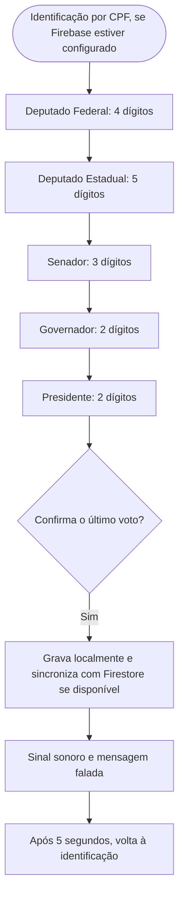

<div align="center">

# 🗳️ Urna Cidadã

**Simulador educativo de votação feito em Java 17 e Swing para um projeto de extensão sobre cidadania digital e desinformação eleitoral.**


</div>

> ⚠️ **Aviso:** este é um projeto **educativo**. Não é um sistema eleitoral oficial e não tem relação com a Justiça Eleitoral. Partidos, números e propostas fazem parte da simulação.

## 📑 Sumário

- [Sobre](#-sobre)
- [Situação do projeto](#-situação-do-projeto)
- [Como executar](#️-como-executar)
- [Como a votação funciona](#️-como-a-votação-funciona)
- [Testes](#-testes)
- [Estrutura](#-estrutura)
- [Documentação](#-documentação)
- [Privacidade e segurança](#-privacidade-e-segurança)
- [Limitações conhecidas](#️-limitações-conhecidas)
- [Resultados da ação de extensão](#-resultados-da-ação-de-extensão)
- [Como contribuir](#-como-contribuir)
- [Equipe](#-equipe)

## 🎯 Sobre

Projeto de extensão da disciplina de **Programação Orientada a Objetos** (Ciência da Computação, 2026.2). Une duas frentes:

1. **O software:** uma urna de demonstração em Java 17 e Swing, com votação em cinco cargos. Os dados são gravados primeiro no computador e, quando o Firebase está configurado e há internet, sincronizados com o Cloud Firestore.
2. **A ação educativa:** uma oficina com estudantes do Ensino Médio para conversar sobre cidadania digital, uso responsável da internet e como identificar desinformação eleitoral.

## 🚧 Situação do projeto

**O software está pronto para demonstração.** Os campos começam vazios; a pessoa digita o número. Quando ele corresponde a um candidato do cargo atual, a urna mostra o nome e o partido. A ação de extensão (oficina com estudantes) ainda será realizada.

| Parte | Situação |
|---|---|
| Votação em cinco cargos (Deputado Federal, Deputado Estadual, Senador, Governador e Presidente), com branco, nulo, legenda e correção | ✅ Implementada e coberta por testes automáticos |
| Candidatos de demonstração | ✅ Inclui as nove candidaturas adicionadas para Presidente, Governador e Deputado Federal; relação completa em `docs/regras-de-votacao.md` |
| Interface Swing, teclado na tela, atalhos e avisos | ✅ Implementada em Java |
| Identificação por CPF e bloqueio de repetição | ✅ Disponível quando o Firebase está configurado |
| Encerramento automático | ✅ Sinal sonoro, mensagem falada e retorno à identificação em cinco segundos |
| Gravação local e fila de pendências para sincronização | ✅ Implementada; o fluxo offline→online tem cobertura automatizada com servidor HTTP local falso |
| Apuração no Cloud Firestore | ✅ Contadores por candidato atualizados junto com cada sessão; regras em `firestore.rules` |
| Pacote portátil para Windows | ✅ Publicado na Release `v1.0.3`, com runtime Java e configuração Firebase |
| Documentação (requisitos, regras, casos de uso, arquitetura, testes e operação da oficina) | ✅ Disponível em `docs/` |
| Material educativo e questionário de impacto | 📝 Modelos prontos; serão usados na oficina |
| Oficina com estudantes | ⬜ A realizar |
| Resultados e avaliação de impacto | ⬜ Depois da oficina |

## ▶️ Como executar

**Para compilar o código-fonte:** JDK 17 ou superior com `java`, `javac`, `jar` e `jpackage`. Maven não é necessário. Quem baixa o ZIP portátil em Releases não precisa instalar Java. Para configurar o Firestore no pacote, siga [firebase-configuracao.md](docs/firebase-configuracao.md).

**Para quem só vai usar a urna no Windows:** baixe o pacote portátil na [Release v1.0.3](https://github.com/Sudo-Marco/urna-cidada/releases/tag/v1.0.3). Extraia o ZIP e abra `UrnaCidada.exe`; o pacote inclui o runtime Java e não exige JDK, VS Code, Git ou Maven.

### Início rápido (Windows)

Na pasta do projeto, dê duplo clique em `demo.bat` para abrir a urna em modo de demonstração: os votos ficam somente na memória. Para iniciar no modo padrão local-primeiro, dê duplo clique em `iniciar.bat`.

No terminal, também é possível executar:

```bat
scripts\demo.bat
scripts\iniciar.bat
scripts\iniciar.bat --local
scripts\iniciar.bat --memoria
scripts\iniciar.bat --ajuda
```

### Modos de gravação

| Comando | Para que serve | Onde ficam os votos |
|---|---|---|
| `scripts\demo.bat` | Demonstração e treino | Só na memória |
| `scripts\iniciar.bat --local` | Gravação somente no computador | Arquivo local de votos |
| `scripts\iniciar.bat --memoria` | Demonstração sem persistência | Só na memória |
| `scripts\iniciar.bat` | Modo padrão local-primeiro | Arquivo local; com Firebase configurado e internet, sincroniza com o Firestore |

A urna grava a sessão localmente antes de tentar enviá-la. Sem internet, ela mantém a sessão pendente no computador e tenta sincronizar automaticamente quando a conexão volta. Sem configuração válida do Firebase, continua funcionando em modo local.

Para o Firestore, configure `urna.properties` ao lado do programa ou use as variáveis indicadas no [guia de configuração](docs/firebase-configuracao.md). Esse arquivo é ignorado pelo Git: não o envie ao GitHub.

<details>
<summary>Linux e macOS</summary>

Há scripts `.sh` correspondentes em `scripts/`. Com JDK 17 ou superior, use, por exemplo:

```bash
sh scripts/demo.sh
sh scripts/iniciar.sh
sh scripts/iniciar.sh --local
sh scripts/testar.sh
```

</details>

## GitHub

O pacote portátil para Windows está na página [Releases](https://github.com/Sudo-Marco/urna-cidada/releases). O ZIP inclui runtime Java; não exige instalar JDK, VS Code, Git ou Maven. O workflow do GitHub executa a suíte de testes e monta o pacote a cada tag `v*`. Para desenvolvimento e execução a partir do código, leia [docs/operacao-oficina.md](docs/operacao-oficina.md).

### Atalhos do teclado do computador

| Tecla | Ação |
|---|---|
| `0` a `9` | Digitar |
| `B` | Voto em branco |
| `Backspace` | Corrigir |
| `Enter` | Confirmar |

## 🗳️ Como a votação funciona



Os cargos permanecem na ordem mostrada no fluxo e definem quantos dígitos o campo aceita. Os números abaixo não são preenchidos pela urna: o eleitor os digita na etapa correspondente.

| Cargo | Dígitos | Candidaturas de exemplo | Partido fictício |
|---|---:|---|---|
| Deputado Federal | 4 | 8101 — Ari Lume; 8202 — Bela Nébula; 8303 — Cael Brisa; 1111 — Pedro Henrique Costa; 2222 — Beatriz Rodrigues; 3333 — André Martins | Partidos fictícios listados em [regras de votação](docs/regras-de-votacao.md) |
| Deputado Estadual | 5 | 81001 — Meia Bomba | Partido Horizonte Comunitário |
| Senador | 3 | 820 — Curupira; 830 — Peter Pardo; 833 — Ivo Pedra-Mansa | Partidos Raízes do Amanhã e Caminhos Abertos |
| Governador | 2 | 84 — Zé Gotinha; 82 — Luma Cedro-Doce; 83 — Nilo Serra-Clara; 44 — Gabriel Santos; 55 — Camila Ferreira; 66 — Lucas Almeida | Partidos fictícios listados em [regras de votação](docs/regras-de-votacao.md) |
| Presidente | 2 | 81 — Pia Sol-Nascente; 85 — Beto; 83 — Tali Nuvem-Mansa; 11 — Rafael Mendes; 22 — Eduardo Carvalho; 33 — Mariana Oliveira | Partidos fictícios listados em [regras de votação](docs/regras-de-votacao.md) |

Ao digitar um número reconhecido, a tela apresenta o candidato e o partido; um número completo que não corresponda ao cargo atual é tratado como voto nulo. As propostas e os partidos estão em [regras-de-votacao.md](docs/regras-de-votacao.md).

- **Voto válido:** número completo de uma candidatura fictícia.
- **Voto de legenda:** opção disponível nos cargos proporcionais.
- **Voto nulo:** número completo que não corresponde a uma candidatura.
- **Voto em branco:** escolha explícita, sem digitar número.
- **Sem internet:** a sessão fica guardada no computador e aguarda a próxima tentativa automática de sincronização.

O Senado é simplificado a um voto. Detalhes em [regras-de-votacao.md](docs/regras-de-votacao.md) e [casos-de-uso.md](docs/casos-de-uso.md).

## 🧪 Testes

No Windows, execute:

```text
scripts\testar.bat
```

Não precisa de Maven nem de internet. A suíte de testes também foi executada com sucesso pelo workflow de publicação da Release `v1.0.3`. A matriz está em [testes.md](docs/testes.md).

Os testes cobrem as regras de votação, a validação de CPF, a persistência local e a sincronização simulada com servidor HTTP local falso. Veja [testes.md](docs/testes.md) para a matriz completa.

## 📁 Estrutura

```text
urna-cidada/
├── scripts/                       demo, iniciar, compilar, testar e empacotar
├── src/com/urnacidada/            código Java da urna
│   ├── model/                     candidatos, cargos, eleição e votos
│   ├── service/                   regras da votação
│   ├── repository/                memória, arquivo local e Firestore REST
│   ├── view/                      controlador e interface Swing
├── firestore.rules                regras do Firestore
├── urna.properties.example        modelo sem chave real
├── tests/                         testes automáticos em Java puro
└── docs/                          requisitos, operação, Firebase e oficina
```

A regra de votação não conhece a tela nem o banco de dados. O diagrama está em [diagrama-classes.md](docs/diagrama-classes.md).

## 📚 Documentação

Índice completo em [docs/README.md](docs/README.md).

| Documento | Conteúdo |
|---|---|
| [requisitos.md](docs/requisitos.md) | O que o sistema deve fazer e a situação de cada requisito |
| [regras-de-votacao.md](docs/regras-de-votacao.md) | Regras, mensagens da tela e dados gravados |
| [casos-de-uso.md](docs/casos-de-uso.md) | Atores e casos de uso |
| [diagrama-classes.md](docs/diagrama-classes.md) | Arquitetura e conceitos de POO aplicados |
| [testes.md](docs/testes.md) | Testes automáticos e roteiro manual |
| [firebase-configuracao.md](docs/firebase-configuracao.md) | Configuração e conferência do Firestore |
| [operacao-oficina.md](docs/operacao-oficina.md) | Preparação técnica e condução da oficina |
| [material-oficina.md](docs/material-oficina.md) | Roteiro pedagógico sobre desinformação |

## 🔒 Privacidade e segurança

- O acesso Firebase pede somente o CPF, no formato `000.000.000-00`. A aplicação valida os dígitos e deriva as credenciais técnicas; não envia nem salva o CPF em texto.
- Cada sessão de voto guarda um UUID aleatório e votos com **cargo, tipo, número e data/hora**.
- `urna.properties` contém a configuração Firebase e está ignorado pelo Git. **Não** envie esse arquivo, dados de votação ou credenciais de serviço ao GitHub.
- A chave de API Firebase é pública por natureza. As regras do Firestore permitem somente a gravação prevista pelo projeto e bloqueiam a leitura das sessões e da apuração pelas contas de participantes.
- Não use este protótipo como sistema eleitoral real.

## ⚠️ Limitações conhecidas

- O CPF é validado pelos dígitos verificadores; a urna não consulta uma base oficial para confirmar o titular.
- A proteção contra voto repetido entre computadores depende de autenticação e regras do Firebase. Os modos `--local` e `--memoria` não fazem esse bloqueio centralizado.
- A apuração fica na coleção `resultados` do Firestore e pode ser consultada pela equipe responsável no Console Firebase.
- O pacote pronto é para Windows 64 bits. Para executar o código-fonte, é necessário JDK 17 ou superior.
- A oficina e a avaliação de impacto ainda não aconteceram; os arquivos de `docs/` são modelos de trabalho.

## 📊 Resultados da ação de extensão

> **A preencher depois da oficina.** Não registre aqui atividades ou resultados que ainda não aconteceram.

| Item | Registro |
|---|---|
| Data e local | _a preencher_ |
| Escola parceira | _a preencher_ |
| Número de participantes | _a preencher_ |
| Principais resultados do questionário | _a preencher_ |
| Aprendizados e melhorias | _a preencher_ |

## 🤝 Como contribuir

| Branch | Para quê |
|---|---|
| `URNA` | Versão final e branch padrão do repositório |
| `feature/nome-da-tarefa` | Cada tarefa nova, criada a partir da branch padrão atualizada |

Mensagens de commit com prefixo: `feat:` (novidade), `fix:` (correção), `docs:` (documentação), `test:` (testes).

Antes de enviar código, rode `scripts\testar.bat` e confira o `git status`. Não inclua `urna.properties` nem dados locais de votação.

## 👥 Equipe

| Integrante | Frentes de atuação |
|---|---|
| **Marco Antônio** | Coordenação do repositório (Git e GitHub, branches e Pull Requests); regras de votação e testes automáticos; persistência no Cloud Firestore e configuração do Firebase; integração e entrega do código |
| **Cauã Reis** | Interface gráfica em Swing (tela, teclado e mensagens ao participante); verificação manual da tela e do teclado; testes de usabilidade no projetor da oficina |
| **Vitória Alves** | Ação de extensão: material educativo sobre desinformação, questionário de impacto e alinhamento com os ODS; contato com a escola e condução da oficina; documentação pedagógica |
| **Vitor dos Anjos Silva de Araujo** | Organização dos candidatos, definição dos números, criação dos partidos e propostas; testes e validações da urna para execução em outro computador |
