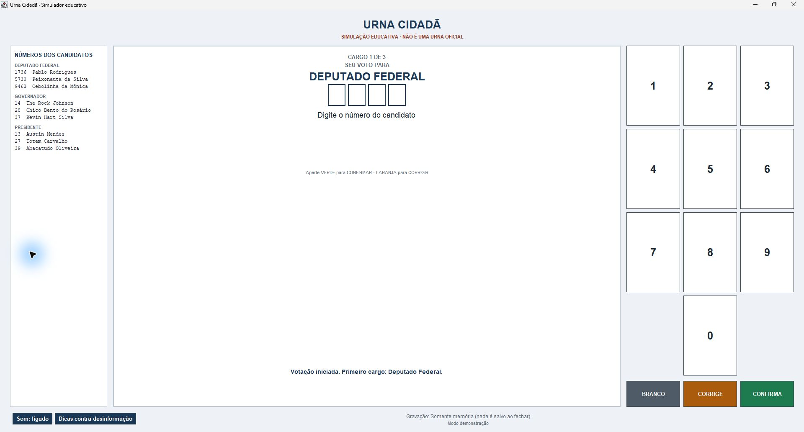
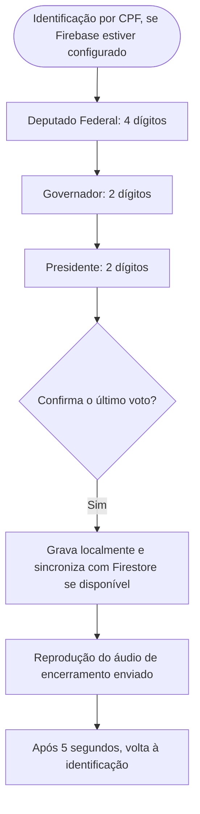
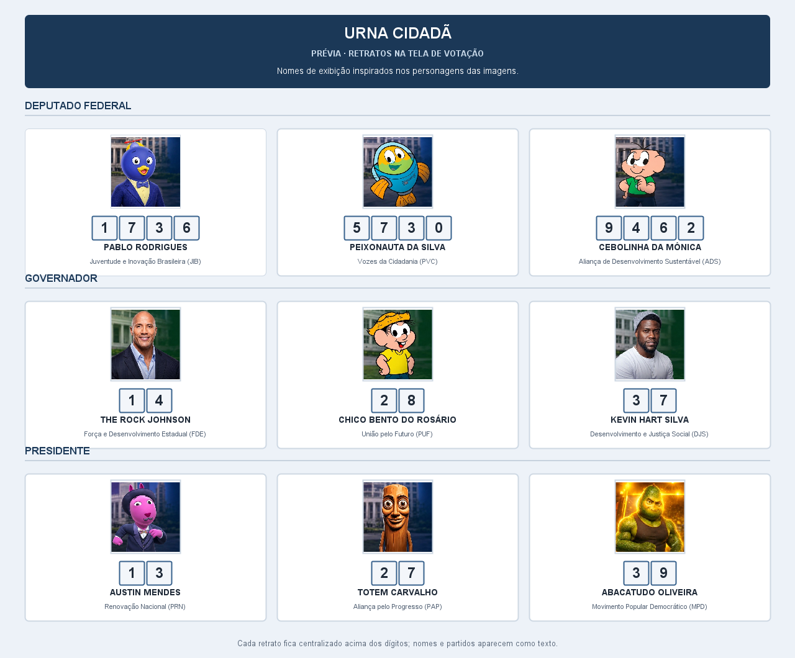

<div align="center">

# 🗳️ Urna Cidadã

**Simulador educativo de votação feito em Java 17 e Swing para um projeto de extensão sobre cidadania digital e desinformação eleitoral.**


</div>

> ⚠️ **Aviso:** este é um projeto **educativo**. Não é um sistema eleitoral oficial e não tem relação com a Justiça Eleitoral. Partidos, números e propostas fazem parte da simulação.



*Captura do aplicativo em execução no modo `--memoria`, sem gravar votos ao fechar.*

## 📑 Sumário

- [Sobre](#-sobre)
- [Como rodar em 3 passos](#como-rodar-em-3-passos)
- [Decisões técnicas](#decisões-técnicas)
- [Situação do projeto](#-situação-do-projeto)
- [Como executar](#️-como-executar)
- [Roadmap](#roadmap)
- [Como a votação funciona](#️-como-a-votação-funciona)
- [Testes](#-testes)
- [Estrutura](#-estrutura)
- [Documentação](#-documentação)
- [Privacidade e segurança](#-privacidade-e-segurança)
- [Limitações conhecidas](#️-limitações-conhecidas)
- [Resultados da ação de extensão](#-resultados-da-ação-de-extensão)
- [Como contribuir](#-como-contribuir)
- [Equipe](#-equipe)
- [Galeria](#galeria)

## 🎯 Sobre

Projeto de extensão da disciplina de **Programação Orientada a Objetos** (Ciência da Computação, 2026.2). Une duas frentes:

1. **O software:** uma urna de demonstração em Java 17 e Swing, com votação em três cargos: Deputado Federal, Governador e Presidente. Os dados são gravados primeiro no computador e, quando o Firebase está configurado e há internet, sincronizados com o Cloud Firestore.
2. **A ação educativa:** uma oficina com estudantes do Ensino Médio para conversar sobre cidadania digital, uso responsável da internet e como identificar desinformação eleitoral.

## Como rodar em 3 passos

1. Instale um JDK 17 ou superior.
2. Clone o repositório e entre na pasta:

   ```powershell
   git clone https://github.com/Sudo-Marco/urna-cidada.git
   cd urna-cidada
   ```

3. No Windows, execute `.\demo.bat`: o script compila o código atual e abre a simulação sem persistir votos.

   ```powershell
   .\demo.bat
   ```

## Decisões técnicas

- Java 17 e Swing mantêm o aplicativo desktop e a demonstração executáveis sem Maven.
- A interface encaminha ações ao controlador e às regras de votação; a persistência fica atrás de repositórios intercambiáveis.
- O modo de demonstração usa memória; os modos local e padrão gravam primeiro no computador. A sincronização com Firestore é opcional e usa a API REST com `HttpClient` do JDK.
- Os dados de votação e partidos são fictícios. O projeto não pretende substituir uma urna oficial.

## 🚧 Situação do projeto

**O software está pronto para demonstração.** Os campos começam vazios; a pessoa digita o número. Quando ele corresponde a um candidato do cargo atual, a urna mostra o nome e o partido. A ação de extensão (oficina com estudantes) ainda será realizada.

| Parte | Situação |
|---|---|
| Votação em três cargos (Deputado Federal, Governador e Presidente), com branco, nulo, legenda e correção | ✅ Implementada e coberta por testes automáticos |
| Candidatos de demonstração | ✅ Nove candidaturas, distribuídas pelos três cargos |
| Interface Swing, teclado na tela, atalhos e avisos | ✅ Implementada em Java |
| Fotos dos candidatos | ✅ Nove retratos da nova colagem aparecem centralizados, sem distorção ou corte dos rostos |
| Tela inicial de identificação | ✅ Entrar, primeiro acesso e CPF reunidos em uma interface personalizada |
| Consulta de números dos candidatos | ✅ Relação fixa no canto superior esquerdo da tela de votação |
| Início pelo terminal | ✅ `iniciar.bat` compila a versão atual e abre a urna sem usar o botão Run do VS Code |
| Identificação com máscara de CPF (11 algarismos) e bloqueio de cadastro repetido | ✅ Disponível quando o Firebase está configurado; não valida dígitos verificadores |
| Encerramento automático | ✅ Reproduz o áudio de encerramento enviado para o projeto e volta à identificação em cinco segundos |
| Gravação local, fila e histórico anônimo | ✅ O histórico continua no computador depois da sincronização |
| Apuração no Cloud Firestore | ✅ Nove contadores por candidato atualizados junto com cada sessão |
| Apuração local offline | ✅ Painel separado por cargo, com votos por candidato e legenda, totais e destaques de mais e menos votado |
| Administração do Firestore | ✅ Restaura coleções sem apagar votos ou inicia uma nova rodada preservando contas |
| Pacote portátil para Windows | ✅ Release `v1.0.16`, com painel offline detalhado, lançador administrativo, runtime Java e dados de demonstração atualizados |
| Documentação (requisitos, regras, casos de uso, arquitetura, testes e operação da oficina) | ✅ Disponível em `docs/` |
| Material educativo e questionário de impacto | 📝 Modelos prontos; serão usados na oficina |
| Oficina com estudantes | ⬜ A realizar |
| Resultados e avaliação de impacto | ⬜ Depois da oficina |

## ▶️ Como executar

**Para compilar o código-fonte:** JDK 17 ou superior com `java`, `javac`, `jar` e `jpackage`. Maven não é necessário. Quem baixa o ZIP portátil em Releases não precisa instalar Java. Para configurar o Firestore no pacote, siga [firebase-configuracao.md](docs/firebase-configuracao.md).

**Para quem só vai usar a urna no Windows:** baixe `UrnaCidada-Windows-x64.zip` na [Release v1.0.16](https://github.com/Sudo-Marco/urna-cidada/releases/tag/v1.0.16). Extraia o ZIP. Abra `UrnaCidada.exe` para votar ou `UrnaCidadaAdmin.exe` para acessar o painel do administrador; o pacote inclui o runtime Java e não exige JDK, VS Code, Git ou Maven.

### Início rápido (Windows)

Na pasta do projeto, dê duplo clique em `demo.bat` para abrir a urna em modo de demonstração: os votos ficam somente na memória. Para iniciar no modo padrão local-primeiro, dê duplo clique em `iniciar.bat`.

No terminal, também é possível executar:

```bat
iniciar.bat
scripts\demo.bat
scripts\iniciar.bat
scripts\iniciar.bat --local
scripts\iniciar.bat --memoria
scripts\iniciar.bat --ajuda
scripts\administrar.bat
```

No terminal integrado do VS Code, aberto na pasta do projeto, execute `.\iniciar.bat`. O comando recompila o código Java atual e abre a urna. A tela inicial reúne o acesso e o primeiro cadastro em um formulário visual com CPF formatado. Durante a votação, os cargos e números dos candidatos ficam visíveis no canto superior esquerdo.

## Roadmap

O software está pronto para demonstração. Os próximos marcos da ação de extensão são realizar a oficina, aplicar o questionário de impacto e registrar os resultados; a oficina ainda não ocorreu e não há resultados a relatar.

### Modos de gravação

| Comando | Para que serve | Onde ficam os votos |
|---|---|---|
| `scripts\demo.bat` | Demonstração e treino | Só na memória |
| `scripts\iniciar.bat --local` | Gravação somente no computador | Arquivo local de votos |
| `scripts\iniciar.bat --memoria` | Demonstração sem persistência | Só na memória |
| `scripts\iniciar.bat` | Modo padrão local-primeiro | Arquivo local; com Firebase configurado e internet, sincroniza com o Firestore |
| `scripts\administrar.bat` | Administração da urna | Apura votos deste computador offline ou reinicia a votação no Firebase |

A urna grava a sessão localmente antes de tentar enviá-la. Quando o Firestore fica indisponível depois da identificação, mantém a votação pendente e a sincroniza quando a conexão volta. Se o Firebase Authentication estiver indisponível ao entrar, a urna oferece continuar no modo offline; o voto fica protegido por um identificador derivado do CPF e só neste computador, sem envio automático. O histórico anônimo permanece no computador mesmo depois do envio, para a apuração local offline. Também é possível abrir diretamente `scripts\iniciar.bat --local`.

Em `scripts\administrar.bat`, escolha **Apuração local offline** para abrir o painel de resultados deste computador. As abas separam Deputado Federal, Governador e Presidente; cada uma mostra os votos nominais por candidato, votos de legenda, brancos, nulos e totais, além de destacar quem tem mais e menos votos no cargo. Empates aparecem juntos. A apuração inclui somente o histórico deste computador e não consulta a nuvem. A primeira utilização administrativa requer preparar o acesso local enquanto há conexão com o Firebase.

No menu Firebase da administração, **Restaurar estrutura do Firestore** cria os contadores ou documentos de controle que estiverem faltando sem apagar votos existentes. **Zerar votação no Firebase** remove as sessões, zera os nove contadores e muda os marcadores `votou` para `false`. As contas Firebase dos CPFs, os documentos de participantes e os administradores são mantidos. Depois do reset, quem já tinha cadastro pode escolher **Entrar**; se escolher **Primeiro acesso**, a urna reutiliza automaticamente a conta existente. Controles sem voto mantêm as coleções `sessoes` e `participantes` visíveis no Console Firestore.

Máquinas que estavam sem conexão podem conservar votos na fila de envio. Limpe os dados locais dessas máquinas antes de reconectá-las, para que votos da rodada anterior não sejam enviados de novo.

Para o Firestore, configure `urna.properties` ao lado do programa ou use as variáveis indicadas no [guia de configuração](docs/firebase-configuracao.md). Esse arquivo é ignorado pelo Git: não o envie ao GitHub.

<details>
<summary>Linux e macOS</summary>

Há scripts `.sh` correspondentes em `scripts/`. Com JDK 17 ou superior, use, por exemplo:

```bash
sh scripts/demo.sh
sh scripts/iniciar.sh
sh scripts/iniciar.sh --local
sh scripts/testar.sh
```

</details>

## GitHub

O pacote portátil para Windows está na página [Releases](https://github.com/Sudo-Marco/urna-cidada/releases). O ZIP inclui runtime Java, `UrnaCidada.exe` e `UrnaCidadaAdmin.exe`; não exige instalar JDK, VS Code, Git ou Maven. O lançador administrativo abre a apuração offline e as ferramentas do Firestore, conforme a conexão disponível. O workflow do GitHub executa a suíte de testes e confere a presença do lançador antes de montar o pacote a cada tag `v*`. Para desenvolvimento e execução a partir do código, leia [docs/operacao-oficina.md](docs/operacao-oficina.md).

### Atalhos do teclado do computador

| Tecla | Ação |
|---|---|
| `0` a `9` | Digitar |
| `B` | Voto em branco |
| `Backspace` | Corrigir |
| `Enter` | Confirmar |

## 🗳️ Como a votação funciona



Os cargos permanecem na ordem mostrada no fluxo e definem quantos dígitos o campo aceita. Os números abaixo não são preenchidos pela urna: o eleitor os digita na etapa correspondente.

| Cargo | Dígitos | Candidaturas de exemplo | Partido fictício |
|---|---:|---|---|
| Deputado Federal | 4 | 1736 — Pablo Rodrigues; 5730 — Peixonauta da Silva; 9462 — Cebolinha da Mônica | Juventude e Inovação Brasileira (JIB); Vozes da Cidadania (PVC); Aliança de Desenvolvimento Sustentável (ADS) |
| Governador | 2 | 14 — The Rock Johnson; 28 — Chico Bento do Rosário; 37 — Kevin Hart Silva | Força e Desenvolvimento Estadual (FDE); União pelo Futuro (PUF); Desenvolvimento e Justiça Social (DJS) |
| Presidente | 2 | 13 — Austin Mendes; 27 — Totem Carvalho; 39 — Abacatudo Oliveira | Renovação Nacional (PRN); Aliança pelo Progresso (PAP); Movimento Popular Democrático (MPD) |

Ao digitar um número reconhecido, o retrato individual do candidato aparece centralizado acima dos campos numéricos, e o nome e partido aparecem abaixo. Os números permanecem centralizados na tela e não são incorporados às imagens. Um número completo que não corresponda ao cargo atual é tratado como voto nulo. As propostas e os partidos estão em [regras-de-votacao.md](docs/regras-de-votacao.md).

O áudio enviado em `som-de-urna-eletronica.zip` foi convertido para WAV e incluído nos recursos do aplicativo. Assim, a reprodução não depende de um codec MP3 instalado no computador.

### Retratos usados na votação

As imagens foram recortadas da colagem enviada para o projeto. A urna mantém a proporção de cada foto e a centraliza no espaço acima dos números. Os nomes de exibição fazem referência às personagens das imagens; cargos, números, partidos e propostas continuam no cadastro da simulação.

*A colagem original dos nove retratos foi mantida na seção [Galeria](#galeria).*

- **Voto válido:** número completo de uma candidatura fictícia.
- **Voto de legenda:** opção disponível nos cargos proporcionais.
- **Voto nulo:** número completo que não corresponde a uma candidatura.
- **Voto em branco:** escolha explícita, sem digitar número.
- **Sem internet:** a sessão fica guardada no computador e aguarda a próxima tentativa automática de sincronização.

Os três cargos e as candidaturas seguem a relação acima. Detalhes em [regras-de-votacao.md](docs/regras-de-votacao.md) e [casos-de-uso.md](docs/casos-de-uso.md).

## 🧪 Testes

No Windows, execute:

```text
scripts\testar.bat
```

Não precisa de Maven nem de internet. O workflow de publicação executa a suíte de testes antes de montar o pacote. A matriz está em [testes.md](docs/testes.md).

Os testes cobrem as regras de votação, o formato do identificador, a persistência local e a sincronização simulada com servidor HTTP local falso. Veja [testes.md](docs/testes.md) para a matriz completa.

## 📁 Estrutura

```text
urna-cidada/
├── scripts/                       demo, iniciar, compilar, testar e empacotar
├── src/com/urnacidada/            código Java da urna
│   ├── model/                     candidatos, cargos, eleição e votos
│   ├── service/                   regras da votação
│   ├── repository/                memória, arquivo local e Firestore REST
│   ├── view/                      controlador e interface Swing
├── src/main/resources/            nove retratos dos candidatos, sem texto sobreposto
├── firestore.rules                regras do Firestore
├── urna.properties.example        modelo sem chave real
├── tests/                         testes automáticos em Java puro
└── docs/                          requisitos, operação, Firebase e oficina
```

A regra de votação não conhece a tela nem o banco de dados. O diagrama está em [diagrama-classes.md](docs/diagrama-classes.md).

## 📚 Documentação

Índice completo em [docs/README.md](docs/README.md).

| Documento | Conteúdo |
|---|---|
| [requisitos.md](docs/requisitos.md) | O que o sistema deve fazer e a situação de cada requisito |
| [regras-de-votacao.md](docs/regras-de-votacao.md) | Regras, mensagens da tela e dados gravados |
| [casos-de-uso.md](docs/casos-de-uso.md) | Atores e casos de uso |
| [diagrama-classes.md](docs/diagrama-classes.md) | Arquitetura e conceitos de POO aplicados |
| [testes.md](docs/testes.md) | Testes automáticos e roteiro manual |
| [firebase-configuracao.md](docs/firebase-configuracao.md) | Configuração e conferência do Firestore |
| [operacao-oficina.md](docs/operacao-oficina.md) | Preparação técnica e condução da oficina |
| [material-oficina.md](docs/material-oficina.md) | Roteiro pedagógico sobre desinformação |

## 🔒 Privacidade e segurança

- O acesso Firebase pede somente um identificador de 11 algarismos no formato `000.000.000-00`, por exemplo `123.456.789-00`. Aceita sequências inventadas sem validar os dígitos verificadores. Deriva credenciais técnicas e não envia nem salva os algarismos em texto.
- Cada sessão de voto guarda um UUID aleatório e votos com **cargo, tipo, número e data/hora**.
- `urna.properties` contém a configuração Firebase e está ignorado pelo Git. **Não** envie esse arquivo, dados de votação ou credenciais de serviço ao GitHub.
- A chave de API Firebase é pública por natureza. As regras do Firestore permitem somente a gravação prevista pelo projeto e bloqueiam a leitura das sessões e da apuração pelas contas de participantes.
- Não use este protótipo como sistema eleitoral real.

## ⚠️ Limitações conhecidas

- O campo usa o formato visual de CPF, mas aceita sequências inventadas de 11 algarismos e não verifica titularidade. O bloqueio central de cadastro repetido depende do Firebase Authentication.
- A proteção contra voto repetido entre computadores depende de autenticação e regras do Firebase. Os modos `--local` e `--memoria` não fazem esse bloqueio centralizado.
- A apuração remota fica na coleção `resultados`; a apuração local soma somente o histórico anônimo guardado no computador atual.
- O acesso administrativo remoto usa uma conta Firebase separada, marcada em `administradores/{uid}`. A limpeza apaga os votos locais apenas do computador em que é executada; outras máquinas precisam ser limpas antes de reconectar filas pendentes.
- O pacote pronto é para Windows 64 bits. Para executar o código-fonte, é necessário JDK 17 ou superior.
- A oficina e a avaliação de impacto ainda não aconteceram; os arquivos de `docs/` são modelos de trabalho.

## 📊 Resultados da ação de extensão

> **A preencher depois da oficina.** Não registre aqui atividades ou resultados que ainda não aconteceram.

| Item | Registro |
|---|---|
| Data e local | _a preencher_ |
| Escola parceira | _a preencher_ |
| Número de participantes | _a preencher_ |
| Principais resultados do questionário | _a preencher_ |
| Aprendizados e melhorias | _a preencher_ |

## 🤝 Como contribuir

| Branch | Para quê |
|---|---|
| `URNA` | Versão final e branch padrão do repositório |
| `feature/nome-da-tarefa` | Cada tarefa nova, criada a partir da branch padrão atualizada |

Mensagens de commit com prefixo: `feat:` (novidade), `fix:` (correção), `docs:` (documentação), `test:` (testes).

Antes de enviar código, rode `scripts\testar.bat` e confira o `git status`. Não inclua `urna.properties` nem dados locais de votação.

## 👥 Equipe

| Integrante | Frentes de atuação |
|---|---|
| **Marco Antônio** | Coordenação do repositório (Git e GitHub, branches e Pull Requests); regras de votação e testes automáticos; persistência no Cloud Firestore e configuração do Firebase; integração e entrega do código |
| **Cauã Reis** | Interface gráfica em Swing (tela, teclado e mensagens ao participante); verificação manual da tela e do teclado; testes de usabilidade no projetor da oficina |
| **Vitória Alves** | Ação de extensão: material educativo sobre desinformação, questionário de impacto e alinhamento com os ODS; contato com a escola e condução da oficina; documentação pedagógica |
| **Vitor dos Anjos Silva de Araujo** | Organização dos candidatos, definição dos números, criação dos partidos e propostas; testes e validações da urna para execução em outro computador |

## Galeria

### Retratos originais dos candidatos


