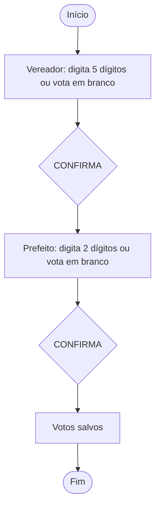
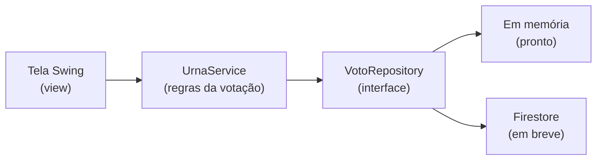

<div align="center">

# 🗳️ Urna Cidadã

**Simulador educativo de urna eletrônica, com ações sobre cidadania digital e desinformação eleitoral.**


</div>

> ⚠️ **Aviso:** este é um projeto **educativo**. Não é um sistema eleitoral oficial e não tem nenhuma relação com a Justiça Eleitoral. Todos os candidatos, partidos e números são **fictícios**.

---

## 📑 Sumário

- [Sobre o projeto](#-sobre-o-projeto)
- [Situação atual](#-situação-atual)
- [Como a votação funciona](#-como-a-votação-funciona)
- [Arquitetura](#-arquitetura)
- [Como executar](#-como-executar)
- [Estrutura de pastas](#-estrutura-de-pastas)
- [Como contribuir](#-como-contribuir)
- [Privacidade e segurança](#-privacidade-e-segurança)
- [Equipe](#-equipe)

---

## 🎯 Sobre o projeto

A **Urna Cidadã** é um projeto de extensão da disciplina de **Programação Orientada a Objetos** (Ciência da Computação, 2026.2).

A ideia é unir tecnologia e educação em duas frentes:

1. **O software:** uma urna eletrônica de brinquedo, em Java, com interface gráfica Swing e armazenamento dos votos de teste no Firebase Cloud Firestore.
2. **A ação educativa:** uma oficina com um questionário, usando a urna como ferramenta para conversar sobre cidadania digital, uso responsável da internet e como identificar desinformação eleitoral.

O objetivo é que as pessoas conheçam o processo de votar de forma leve e prática, sem que nenhum dado pessoal seja coletado.

---

## 🚧 Situação atual

| Parte | Situação |
|---|---|
| Lógica da votação (cargos, branco, corrigir, confirmar, nulo) | ✅ Pronta, com testes |
| Persistência em memória (para desenvolvimento) | ✅ Pronta |
| Interface gráfica (Swing) | 🔲 A fazer |
| Persistência no Firestore | 🔲 A fazer |
| Material educativo e oficina | 🔲 A fazer |
| Capturas de tela | 🔲 Quando a interface existir |

**Prazo de entrega acadêmica:** 30/11/2026.

---

## 🗳️ Como a votação funciona

O eleitor vota em **dois cargos**, nesta ordem:

| Cargo | Dígitos do número |
|---|---|
| Vereador | 5 |
| Prefeito | 2 |



**Regras:**

- Só são aceitos **números**, e no máximo a quantidade de dígitos do cargo.
- **Branco** só é possível se nenhum dígito foi digitado.
- **Corrige** apaga o que foi digitado (ou o branco) no cargo atual.
- **Confirma** exige o número completo ou o voto em branco.
- Se o número completo **não existe**, o voto é **nulo**.
- Os votos só são gravados ao confirmar o **último** cargo.
- Se a gravação falhar (por exemplo, sem internet), a votação **não** é encerrada e é possível tentar de novo.

> As regras ainda são um rascunho e podem mudar após validação do grupo e do professor.

---

## 🏗️ Arquitetura

O código é separado em camadas. A lógica **não conhece** a tela nem o banco de dados, o que permite trabalhar em cada parte em paralelo e trocar o banco sem mexer nas regras.



---

## ▶️ Como executar

**Pré-requisito:** JDK 21 ou superior instalado. Confira no terminal:

```bash
java -version
javac -version
```

Na pasta do projeto, use os scripts (PowerShell ou CMD, no Windows):

| O que fazer | Comando |
|---|---|
| Compilar | `.\scripts\compilar.bat` |
| Compilar e rodar a urna | `.\scripts\rodar.bat` |
| Compilar e rodar os testes | `.\scripts\testar.bat` |

Os testes devem terminar com `16 passaram, 0 falharam`.

<details>
<summary>Prefere os comandos manuais (qualquer sistema)?</summary>

```bash
# compilar
javac -encoding UTF-8 -d out -sourcepath src src/com/urnacidada/Main.java

# rodar a urna no terminal
java -cp out com.urnacidada.Main

# compilar e rodar os testes
javac -encoding UTF-8 -d out -sourcepath src tests/TesteUrna.java
java -cp out TesteUrna
```

Se os acentos aparecerem trocados no Windows, rode `chcp 65001` antes.

</details>

No **VS Code**, também dá para abrir `src/com/urnacidada/Main.java` e clicar em **Run**, com a extensão *Extension Pack for Java*.

---

## 📁 Estrutura de pastas

```text
urna-cidada/
├── README.md
├── .gitignore
├── scripts/                  compilar.bat, rodar.bat, testar.bat
├── docs/                     documentação e requisitos
├── src/com/urnacidada/
│   ├── Main.java             ponto de entrada
│   ├── model/                Candidato, Cargo, Voto, TipoVoto, Eleicao
│   ├── service/              UrnaService (regras da votação)
│   ├── repository/           VotoRepository e versão em memória
│   └── view/                 telas Swing (em desenvolvimento)
└── tests/                    TesteUrna.java
```

---

## 🤝 Como contribuir

**Branches**

| Branch | Para quê |
|---|---|
| `main` | Versão estável, pronta para entrega |
| `develop` | Integração do trabalho de todos |
| `feature/nome-da-tarefa` | Cada tarefa nova (ex.: `feature/tela-urna`) |

**Mensagens de commit** com prefixo:

| Prefixo | Uso |
|---|---|
| `feat:` | Funcionalidade nova |
| `fix:` | Correção de erro |
| `docs:` | Documentação |
| `test:` | Testes |

**Antes de enviar:** rode `.\scripts\testar.bat` e confira o `git status`.

---

## 🔒 Privacidade e segurança

- O voto é **anônimo**: são guardados apenas o cargo, o tipo do voto (válido, branco ou nulo), o número e a data/hora. **Nada** sobre quem votou.
- **Não** são coletados dados pessoais dos participantes.
- **Nunca** envie ao GitHub senhas, chaves ou credenciais do Firebase (como `serviceAccountKey.json`). O `.gitignore` já bloqueia esses arquivos.

---

## 👥 Equipe

| Integrante | Frente |
|---|---|
| _a preencher_ | _a preencher_ |
| _a preencher_ | _a preencher_ |
| _a preencher_ | _a preencher_ |
| _a preencher_ | _a preencher_ |
| _a preencher_ | _a preencher_ |

---

<div align="center">

Projeto educativo · Ciência da Computação · Programação Orientada a Objetos · 2026.2

</div>
