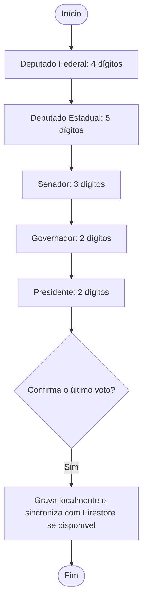

<div align="center">

# 🗳️ Urna Cidadã

**Simulador educativo de votação em Java 17, com interface Swing e opção web local; ações sobre cidadania digital e desinformação eleitoral.**


</div>

> ⚠️ **Aviso:** este é um projeto **educativo**. Não é um sistema eleitoral oficial e não tem relação com a Justiça Eleitoral. Partidos, números e propostas são fictícios. Os nomes do cargo estadual foram definidos a pedido do usuário; “Curupira” e “Zé Gotinha” remetem a personagens conhecidos, então confirme com o professor se esses nomes atendem à rubrica.

## 📑 Sumário

- [Sobre](#-sobre)
- [Situação do projeto](#-situação-do-projeto)
- [Como executar](#️-como-executar)
- [Como a votação funciona](#️-como-a-votação-funciona)
- [Testes](#-testes)
- [Estrutura](#-estrutura)
- [Documentação](#-documentação)
- [Privacidade e segurança](#-privacidade-e-segurança)
- [Limitações conhecidas](#️-limitações-conhecidas)
- [Resultados da ação de extensão](#-resultados-da-ação-de-extensão)
- [Como contribuir](#-como-contribuir)
- [Equipe](#-equipe)

## 🎯 Sobre

Projeto de extensão da disciplina de **Programação Orientada a Objetos** (Ciência da Computação, 2026.2). Une duas frentes:

1. **O software:** uma urna de demonstração em Java 17, com interface Swing e votação em cinco cargos. Os dados são gravados primeiro no computador e, quando o Firebase está configurado e há internet, sincronizados com o Cloud Firestore.
2. **A ação educativa:** uma oficina com estudantes do Ensino Médio para conversar sobre cidadania digital, uso responsável da internet e como identificar desinformação eleitoral.

## 🚧 Situação do projeto

**O software está pronto para demonstração.** O cargo Deputado Estadual tem cinco candidaturas de exemplo; a ação de extensão (oficina com estudantes) ainda será realizada.

| Parte | Situação |
|---|---|
| Votação em cinco cargos (Deputado Federal, Deputado Estadual, Senador, Governador e Presidente), com branco, nulo, legenda e correção | ✅ Implementada e coberta por testes automáticos |
| Cinco candidaturas de Deputado Estadual | ✅ Nomes pedidos, números de cinco dígitos, partidos e propostas fictícias |
| Interface Swing (teclado na tela, atalhos e avisos) sem painel lateral | ✅ Implementada; a urna foi aberta no computador do usuário |
| Gravação local e fila de pendências para sincronização | ✅ Implementada; o fluxo offline→online tem cobertura automatizada com servidor HTTP local falso |
| Gravação no Cloud Firestore | ✅ Configurada no computador do usuário; a tela mostrou “Online · tudo enviado” e o usuário informou que uma sessão de teste foi salva. A conferência direta do documento no console ainda está pendente. |
| Documentação (requisitos, regras, casos de uso, arquitetura, testes e operação da oficina) | ✅ Disponível em `docs/` |
| Material educativo e questionário de impacto | 📝 Modelos prontos; serão usados na oficina |
| Oficina com estudantes | ⬜ A realizar |
| Resultados e avaliação de impacto | ⬜ Depois da oficina |

## ▶️ Como executar

**Para compilar o código-fonte:** JDK 17 ou superior com `java`, `javac`, `jar` e `jpackage`. Maven não é necessário. Quem baixa o ZIP portátil em Releases não precisa instalar Java. Para configurar o Firestore no pacote, siga [firebase-configuracao.md](docs/firebase-configuracao.md).

**Para quem só vai usar a urna no Windows:** baixe o pacote portátil na página [Releases](https://github.com/Sudo-Marco/urna-cidada/releases). Extraia o ZIP e abra `UrnaCidada.exe`; o pacote inclui o runtime Java e não exige JDK, VS Code, Git ou Maven. Se ainda não houver uma versão em Releases, use temporariamente o código-fonte seguindo os passos abaixo; a publicação automática é iniciada ao criar uma tag `v*` no GitHub.

### Início rápido (Windows)

Na pasta do projeto, dê duplo clique em `demo.bat` para abrir a urna em modo de demonstração: os votos ficam somente na memória. Para iniciar no modo padrão local-primeiro, dê duplo clique em `iniciar.bat`.

No terminal, também é possível executar:

```bat
scripts\demo.bat
scripts\iniciar.bat
scripts\iniciar.bat --local
scripts\iniciar.bat --memoria
scripts\iniciar.bat --ajuda
```

### Modos de gravação

| Comando | Para que serve | Onde ficam os votos |
|---|---|---|
| `scripts\demo.bat` | Demonstração e treino | Só na memória |
| `scripts\iniciar.bat --local` | Gravação somente no computador | Arquivo local de votos |
| `scripts\iniciar.bat --memoria` | Demonstração sem persistência | Só na memória |
| `scripts\iniciar.bat` | Modo padrão local-primeiro | Arquivo local; com Firebase configurado e internet, sincroniza com o Firestore |

A urna grava a sessão localmente antes de tentar enviá-la. Sem internet, ela mantém a sessão pendente no computador e tenta sincronizar automaticamente quando a conexão volta. Sem configuração válida do Firebase, continua funcionando em modo local.

Para o Firestore, configure `urna.properties` ao lado do programa ou use as variáveis indicadas no [guia de configuração](docs/firebase-configuracao.md). Esse arquivo é ignorado pelo Git: não o envie ao GitHub.

<details>
<summary>Linux e macOS</summary>

Há scripts `.sh` correspondentes em `scripts/`. Com JDK 17 ou superior, use, por exemplo:

```bash
sh scripts/demo.sh
sh scripts/iniciar.sh
sh scripts/iniciar.sh --local
sh scripts/testar.sh
```

Os scripts existem, mas não foram verificados em Linux/macOS nesta revisão.

</details>

## Usar no navegador sem Maven

O projeto inclui uma interface web servida por Java. Ela reutiliza as regras de votação e os repositórios existentes; o navegador mostra a tela e o servidor local continua responsável por validar e gravar os votos. É necessário apenas o JDK 17+.

No Windows, dê duplo clique em `web.bat` ou execute no terminal:

```bat
scripts\servir.bat
scripts\servir.bat --local
scripts\servir.bat --memoria
```

Abra `http://127.0.0.1:8080`. A primeira opção usa o armazenamento local-primeiro já documentado; `--local` grava só no arquivo local e `--memoria` não mantém votos ao encerrar. Deixe o terminal aberto enquanto usa a página; `Ctrl+C` encerra o servidor. Para mudar a porta, defina a variável `URNA_WEB_PORT` antes de iniciar.

O servidor escuta apenas em `127.0.0.1`, neste computador. Para outras pessoas acessarem pela rede ou pela internet, seria necessário hospedar o servidor e rever autenticação, segurança e persistência.

## GitHub

O pacote portátil para Windows está na página [Releases](https://github.com/Sudo-Marco/urna-cidada/releases). O ZIP inclui runtime Java; não exige instalar JDK, VS Code, Git ou Maven. O GitHub Pages hospeda somente páginas estáticas e não executa o servidor Java desta interface web. Para desenvolvimento e execução a partir do código, leia [docs/operacao-oficina.md](docs/operacao-oficina.md).

### Atalhos do teclado do computador

| Tecla | Ação |
|---|---|
| `0` a `9` | Digitar |
| `B` | Voto em branco |
| `Backspace` | Corrigir |
| `Enter` | Confirmar |

## 🗳️ Como a votação funciona



- **Voto válido:** número completo de uma candidatura fictícia.
- **Voto de legenda:** opção disponível nos cargos proporcionais.
- **Voto nulo:** número completo que não corresponde a uma candidatura.
- **Voto em branco:** escolha explícita, sem digitar número.
- **Sem internet:** a sessão fica guardada no computador e aguarda a próxima tentativa automática de sincronização.

O Senado é simplificado a um voto. Detalhes em [regras-de-votacao.md](docs/regras-de-votacao.md) e [casos-de-uso.md](docs/casos-de-uso.md).

## 🧪 Testes

No Windows, execute:

```text
scripts\testar.bat
```

Não precisa de Maven nem de internet. Na revisão registrada em [testes.md](docs/testes.md), a suíte foi executada nesta máquina; veja ali o resultado atual e os limites da verificação.

Os testes cobrem as regras de votação, a persistência local e a sincronização simulada com servidor HTTP local falso. **Não comprovam** a aparência em todos os computadores, a realização da oficina nem o impacto educativo; também não substituem o teste de uma queda real de internet. A tela do usuário mostrou “Firebase configurado” e “Online · tudo enviado”, e o usuário informou que a sessão de teste foi salva. A inspeção independente do documento no console Firestore ainda está pendente. Veja [testes.md](docs/testes.md) para a matriz e as conferências manuais.

## 📁 Estrutura

```text
urna-cidada/
├── scripts/                       demo, iniciar, compilar, testar e empacotar
├── src/com/urnacidada/            código Java da urna
│   ├── model/                     candidatos, cargos, eleição e votos
│   ├── service/                   regras da votação
│   ├── repository/                memória, arquivo local e Firestore REST
│   ├── view/                      controlador e interface Swing
│   └── WebMain.java               servidor local da interface web
├── web/                           interface HTML/CSS/JavaScript
├── firestore.rules                regras do Firestore
├── urna.properties.example        modelo sem chave real
├── tests/                         testes automáticos em Java puro
└── docs/                          requisitos, operação, Firebase e oficina
```

A regra de votação não conhece a tela nem o banco de dados. O diagrama está em [diagrama-classes.md](docs/diagrama-classes.md).

## 📚 Documentação

Índice completo em [docs/README.md](docs/README.md).

| Documento | Conteúdo |
|---|---|
| [requisitos.md](docs/requisitos.md) | O que o sistema deve fazer e a situação de cada requisito |
| [regras-de-votacao.md](docs/regras-de-votacao.md) | Regras, mensagens da tela e dados gravados |
| [casos-de-uso.md](docs/casos-de-uso.md) | Atores e casos de uso |
| [diagrama-classes.md](docs/diagrama-classes.md) | Arquitetura e conceitos de POO aplicados |
| [testes.md](docs/testes.md) | Testes automáticos e roteiro manual |
| [firebase-configuracao.md](docs/firebase-configuracao.md) | Configuração e conferência do Firestore |
| [operacao-oficina.md](docs/operacao-oficina.md) | Preparação técnica e condução da oficina |
| [material-oficina.md](docs/material-oficina.md) | Roteiro pedagógico sobre desinformação |

## 🔒 Privacidade e segurança

- Cada sessão guarda um UUID aleatório e votos com **cargo, tipo, número e data/hora**. O programa não pede nome, e-mail ou matrícula.
- `urna.properties` contém a configuração Firebase e está ignorado pelo Git. **Não** envie esse arquivo, dados de votação ou credenciais de serviço ao GitHub.
- A chave de API Firebase é pública por natureza. As regras do Firestore permitem somente a gravação prevista pelo projeto e negam leitura, atualização e remoção anônimas. Isso não comprova a identidade de quem votou nem impede tentativas de abuso.
- Não use este protótipo como sistema eleitoral real.

## ⚠️ Limitações conhecidas

- A configuração real do Firestore está no computador do usuário. A tela mostrou o estado online e o usuário informou que a sessão de teste foi salva; a conferência direta no console e o teste manual de reconexão após uma queda real de internet ainda estão pendentes.
- Para usar em outro computador, é necessário JDK 17 ou superior. Para sincronizar com o Firestore, também é necessária uma configuração Firebase local naquele computador.
- A aparência em projetor e em escalas diferentes, o teclado físico e o áudio precisam de conferência nos equipamentos da oficina. Linux/macOS não foram testados nesta revisão.
- Os candidatos e cargos são de exemplo (`Eleicao.exemplo()`). Requisitos exclusivos da rubrica do professor não foram conferidos porque o PDF não estava disponível.
- A oficina e a avaliação de impacto ainda não aconteceram; os arquivos de `docs/` são modelos de trabalho.

## 📊 Resultados da ação de extensão

> **A preencher depois da oficina.** Não registre aqui atividades ou resultados que ainda não aconteceram.

| Item | Registro |
|---|---|
| Data e local | _a preencher_ |
| Escola parceira | _a preencher_ |
| Número de participantes | _a preencher_ |
| Principais resultados do questionário | _a preencher_ |
| Aprendizados e melhorias | _a preencher_ |

## 🤝 Como contribuir

| Branch | Para quê |
|---|---|
| `URNA` | Versão final e branch padrão do repositório |
| `feature/nome-da-tarefa` | Cada tarefa nova, criada a partir da branch padrão atualizada |

Mensagens de commit com prefixo: `feat:` (novidade), `fix:` (correção), `docs:` (documentação), `test:` (testes).

Antes de enviar código, rode `scripts\testar.bat` e confira o `git status`. Não inclua `urna.properties` nem dados locais de votação.

## 👥 Equipe

| Integrante | Frentes de atuação |
|---|---|
| **Marco Antônio** | Coordenação do repositório (Git e GitHub, branches e Pull Requests); regras de votação e testes automáticos; persistência no Cloud Firestore e configuração do Firebase; integração e entrega do código |
| **Cauã Reis** | Interface gráfica em Swing (tela, teclado e mensagens ao participante); verificação manual da tela e do teclado; testes de usabilidade no projetor da oficina |
| **Vitória Alves** | Ação de extensão: material educativo sobre desinformação, questionário de impacto e alinhamento com os ODS; contato com a escola e condução da oficina; documentação pedagógica |
