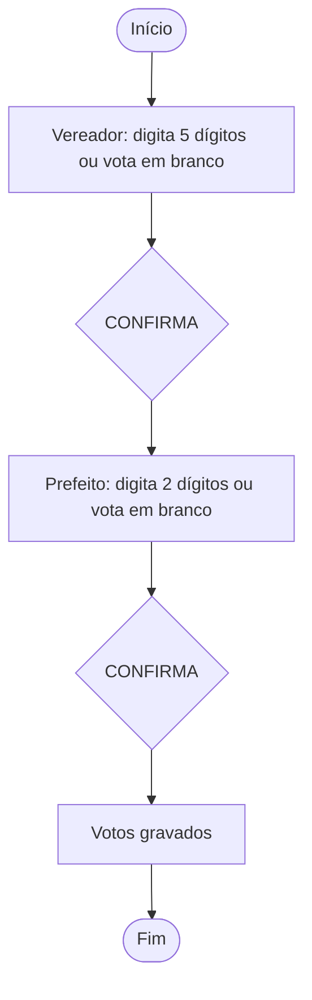

<div align="center">

# 🗳️ Urna Cidadã

**Simulador educativo de urna eletrônica, com ações sobre cidadania digital e desinformação eleitoral.**


</div>

> ⚠️ **Aviso:** este é um projeto **educativo**. Não é um sistema eleitoral oficial e não tem relação com a Justiça Eleitoral. Todos os candidatos, partidos e números são **fictícios**.

## 📑 Sumário

- [Sobre](#-sobre)
- [Situação do projeto](#-situação-do-projeto)
- [Como executar](#️-como-executar)
- [Como a votação funciona](#️-como-a-votação-funciona)
- [Testes](#-testes)
- [Estrutura](#-estrutura)
- [Documentação](#-documentação)
- [Privacidade e segurança](#-privacidade-e-segurança)
- [Limitações conhecidas](#️-limitações-conhecidas)
- [Como contribuir](#-como-contribuir)
- [Equipe](#-equipe)

## 🎯 Sobre

Projeto de extensão da disciplina de **Programação Orientada a Objetos** (Ciência da Computação, 2026.2). Une duas frentes:

1. **O software:** uma urna de brinquedo em Java, com interface Swing e gravação anônima dos votos no Cloud Firestore.
2. **A ação educativa:** uma oficina com estudantes do Ensino Médio, usando a urna para conversar sobre cidadania digital, uso responsável da internet e como identificar desinformação eleitoral.

## 🚧 Situação do projeto

| Parte | Situação |
|---|---|
| Votação em dois cargos (Vereador e Prefeito) com branco, nulo e correção | ✅ Pronta, com 67 testes automáticos |
| Interface Swing (teclado na tela e do computador, avisos por cor, dicas) | ✅ Pronta. Falta conferir na janela real e no projetor ([roteiro](docs/testes.md#roteiro-de-verificação-manual)) |
| Gravação local em arquivo e reserva automática sem internet | ✅ Pronta e testada |
| Gravação no Cloud Firestore | ✅ Testada com um projeto real em 25/10/2026: gravação anônima e reenvio dos votos guardados quando a internet cai |
| Material educativo e questionário | 📝 Modelos prontos, ainda não aplicados |
| Oficina com estudantes | ⬜ Ainda não realizada |

## ▶️ Como executar

**Requisitos:** JDK 17 ou superior e Maven 3.9 ou superior (`java -version` e `mvn -version` devem funcionar). Para usar o Firestore, veja [operacao-oficina.md](docs/operacao-oficina.md).

### Início rápido (Windows)

Na pasta do projeto:

```text
scripts\demo.bat
```

Abre a urna em modo demonstração: nada é salvo ao fechar e não usa internet.

### Modos de gravação

| Comando | Para que serve | Onde ficam os votos |
|---|---|---|
| `scripts\demo.bat` | Demonstração e treino | Só na memória |
| `scripts\rodar.bat --local` | Uso sem internet | `dados\votos-locais.tsv` |
| `scripts\rodar.bat` | Uso com Firestore | Nuvem; se a rede falhar, `dados\votos-pendentes.tsv` e envio depois |

Se `FIRESTORE_PROJECT_ID` não estiver definido, ou o Firestore não puder ser iniciado, a urna **avisa** e usa o arquivo local.

<details>
<summary>Sem os scripts (qualquer sistema)</summary>

```bash
mvn compile exec:java -Dexec.args="--memoria"     # demonstração
mvn compile exec:java -Dexec.args="--local"       # arquivo local
mvn compile exec:java                             # Firestore com reserva local
```

</details>

### Atalhos do teclado do computador

| Tecla | Ação |
|---|---|
| `0` a `9` | Digitar |
| `B` | Voto em branco |
| `Backspace` | Corrigir |
| `Enter` | Confirmar |

## 🗳️ Como a votação funciona



- **Voto válido:** número completo de um candidato.
- **Voto nulo:** número completo que não existe; a tela avisa antes de confirmar.
- **Voto em branco:** escolha explícita, sem digitar número.
- **Sem internet:** os votos ficam guardados no computador e são enviados depois.

Detalhes em [regras-de-votacao.md](docs/regras-de-votacao.md) e [casos-de-uso.md](docs/casos-de-uso.md).

## 🧪 Testes

```text
scripts\testar.bat
```

Não precisa de Maven nem de internet. O resultado esperado termina com `67 passaram, 0 falharam`.

Os testes cobrem as regras de votação, a persistência (memória, arquivo e reserva), o que a tela mostra em cada situação e a montagem da interface sem abrir janela. **Não comprovam** a aparência em todos os computadores, a realização da oficina nem o impacto educativo. A conexão com o Firestore foi conferida manualmente (ver [testes.md](docs/testes.md)). Ver [testes.md](docs/testes.md).

## 📁 Estrutura

```text
urna-cidada/
├── pom.xml
├── scripts/                  demo.bat, rodar.bat, compilar.bat, testar.bat
├── src/com/urnacidada/
│   ├── Main.java             escolhe o modo de gravação e abre a tela
│   ├── model/                Candidato (abstrata) e subclasses, Cargo, Eleicao, Voto
│   ├── service/              UrnaService (regras da votação)
│   ├── repository/           VotoRepository e suas implementações
│   └── view/                 ControladorUrna, PainelUrna, TelaUrna
├── tests/com/urnacidada/testes/   67 testes em Java puro
└── docs/                     requisitos, regras, casos de uso, arquitetura, testes e oficina
```

A regra de votação não conhece a tela nem o banco de dados. Diagramas em [diagrama-classes.md](docs/diagrama-classes.md).

## 📚 Documentação

Índice completo em [docs/README.md](docs/README.md).

| Documento | Conteúdo |
|---|---|
| [requisitos.md](docs/requisitos.md) | O que o sistema deve fazer e a situação de cada requisito |
| [regras-de-votacao.md](docs/regras-de-votacao.md) | Regras, mensagens da tela e dados gravados |
| [casos-de-uso.md](docs/casos-de-uso.md) | Atores e casos de uso |
| [diagrama-classes.md](docs/diagrama-classes.md) | Arquitetura e conceitos de POO aplicados |
| [testes.md](docs/testes.md) | Testes automáticos e roteiro manual |
| [operacao-oficina.md](docs/operacao-oficina.md) | Preparação técnica e condução da oficina |
| [material-oficina.md](docs/material-oficina.md) | Roteiro pedagógico sobre desinformação |

## 🔒 Privacidade e segurança

- Cada voto guarda apenas **cargo, tipo, número e data/hora**. Nada identifica o participante: sem nome, e-mail, matrícula ou endereço IP.
- Cada votação gera um identificador aleatório de sessão. Repetir a gravação atualiza o mesmo registro.
- **Nunca** envie ao GitHub chaves, `serviceAccountKey.json`, arquivos `.env` ou a pasta `dados/`. O `.gitignore` já bloqueia esses nomes.
- O modo Firestore usa credenciais ADC no computador de quem executa. Use uma conta de desenvolvimento com permissões limitadas e **não distribua credenciais** junto com o aplicativo. Para uso público, a escrita deveria passar por um backend controlado.

## ⚠️ Limitações conhecidas

- O Firestore foi testado com um projeto real, mas em um único computador (o de desenvolvimento). O uso em outro computador, como o da escola, exige autenticar a conta nele e ainda precisa ser conferido.
- A janela foi aberta e conferida no computador de desenvolvimento; falta conferir no projetor e no computador da oficina.
- Candidatos e cargos são de exemplo (`Eleicao.exemplo()`).
- As regras de votação ainda precisam ser validadas pelo grupo e pelo professor.
- A oficina e a avaliação de impacto ainda não aconteceram; os arquivos em `docs/` são modelos de trabalho.

## 🤝 Como contribuir

| Branch | Para quê |
|---|---|
| `main` | Versão estável |
| `develop` | Integração do trabalho de todos |
| `feature/nome-da-tarefa` | Cada tarefa nova, criada a partir da `develop` atualizada |

Mensagens de commit com prefixo: `feat:` (novidade), `fix:` (correção), `docs:` (documentação), `test:` (testes).

Antes de enviar: rode `scripts\testar.bat` e confira o `git status`.

## 👥 Equipe

| Integrante | Frentes de atuação |
|---|---|
| **Marco Antônio** | Coordenação do repositório (Git e GitHub, branches e Pull Requests); regras de votação e testes automáticos; persistência no Cloud Firestore e configuração do Firebase; integração e entrega do código |
| **Cauã Reis** | Interface gráfica em Swing (tela, teclado e mensagens ao participante); verificação manual da tela e do teclado; testes de usabilidade no projetor da oficina |
| **Vitória Alves** | Ação de extensão: material educativo sobre desinformação, questionário de impacto e alinhamento com os ODS; contato com a escola e condução da oficina; documentação pedagógica |

> A tabela indica a área de responsabilidade de cada integrante. Outros participantes do grupo podem ser acrescentados aqui.
