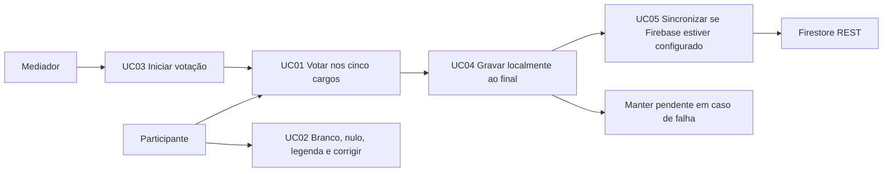

# Casos de uso

> Atores e fluxos do simulador. Veja [regras-de-votacao.md](regras-de-votacao.md) para regras e formatos.

## Atores

| Ator | Papel |
|---|---|
| Participante | Escolhe um voto por cargo na simulação |
| Mediador | Inicia a urna, orienta a atividade e pode iniciar a sessão seguinte |
| Firestore | Destino opcional de cópia das sessões anônimas |

## Visão geral

### UC01 — Votar nos cinco cargos

| Item | Descrição |
|---|---|
| Pré-condição | Aplicativo aberto; aviso de simulação visível |
| Fluxo | 1. Votar em Deputado Federal. 2. Conferir a candidatura/legenda e confirmar. 3. Repetir para Deputado Estadual, Senador, Governador e Presidente. 4. O sistema persiste a sessão e mostra FIM. |
| Alternativas | Número completo não cadastrado pode ser corrigido ou confirmado como nulo. Branco é escolha explícita. Número incompleto não pode ser confirmado. |
| Pós-condição | Cinco escolhas anônimas compõem a mesma sessão. |
| Limite didático | A simulação pede apenas um voto para Senador. |

### UC02 — Corrigir, branco, nulo ou legenda

O participante pode corrigir os dados antes de confirmar. Branco só é disponível quando nenhum algarismo foi digitado. Nos cargos proporcionais, dois algarismos de partido podem ser confirmados como voto de legenda.

### UC03 — Iniciar uma votação

O mediador executa `iniciar.bat` (modo padrão), `scripts\iniciar.bat --local` ou `demo.bat`. A votação começa no cargo federal. Depois do FIM, botão “Iniciar nova votação” cria outro UUID de sessão.

### UC04 — Gravar localmente

No último CONFIRMA, o sistema grava primeiro um arquivo TSV UTF-8 por substituição atômica. Falha local é reportada e permite tentar novamente; a votação só é encerrada depois que o repositório aceita a gravação.

### UC05 — Sincronizar com Firestore

Se `urna.properties` ou as variáveis de ambiente contiverem configuração válida, a sessão local é enviada em segundo plano pela API REST. HTTP 200 ou 409 conclui e remove a linha local. Falha transitória mantém o registro e agenda nova tentativa com recuo. Erro de configuração mantém os votos locais e suspende retentativas automáticas. A configuração passo a passo está em [firebase-configuracao.md](firebase-configuracao.md).
