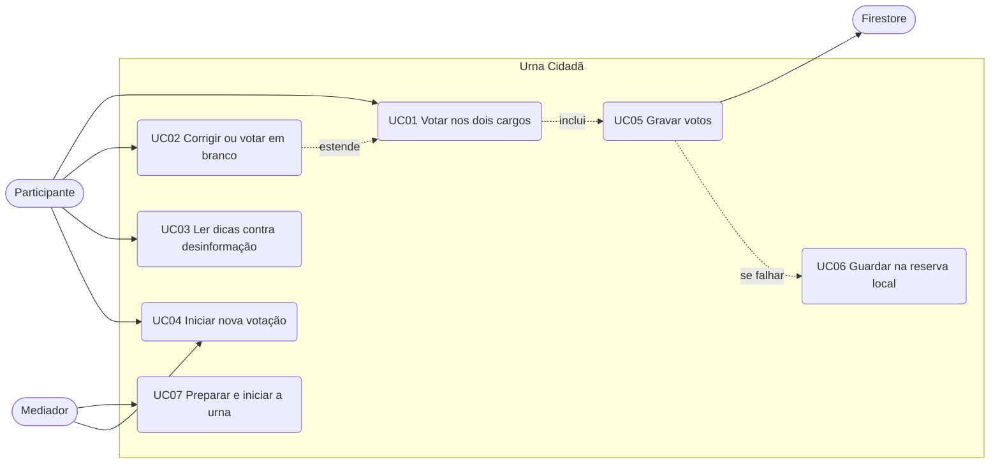

# Casos de uso

> Mostram o que cada pessoa faz com o sistema. Relacionam-se com [requisitos.md](requisitos.md) e [regras-de-votacao.md](regras-de-votacao.md).

## Atores

| Ator | Quem é |
|---|---|
| Participante | Estudante que usa a urna na oficina |
| Mediador | Integrante do grupo que conduz a oficina e prepara o equipamento |
| Firestore | Serviço externo que guarda os votos anônimos |

## Diagrama

## Descrição

### UC01 — Votar nos dois cargos

| Item | Descrição |
|---|---|
| Ator | Participante |
| Pré-condição | Urna aberta e pronta |
| Fluxo principal | 1. Digita o número do candidato a Vereador. 2. Confere o candidato mostrado. 3. Aperta CONFIRMA. 4. Repete para Prefeito. 5. O sistema grava os votos (UC05) e mostra "FIM" |
| Fluxos alternativos | **A.** Número inexistente: a tela avisa "NÚMERO ERRADO / VOTO NULO"; o participante pode corrigir ou confirmar. **B.** Confirmar com número incompleto: a tela explica o erro e não avança. **C.** Falha na gravação: a tela avisa e permite confirmar de novo |
| Pós-condição | Dois votos anônimos gravados; teclas desabilitadas até nova votação |
| Requisitos | RF02 a RF08 |

### UC02 — Corrigir ou votar em branco

| Item | Descrição |
|---|---|
| Ator | Participante |
| Fluxo | CORRIGE apaga os dígitos ou o branco. BRANCO marca voto em branco, desde que nenhum dígito tenha sido digitado |
| Erro | BRANCO depois de digitar mostra "use CORRIGE antes" |
| Requisito | RF07 |

### UC03 — Ler dicas contra desinformação

| Item | Descrição |
|---|---|
| Ator | Participante |
| Fluxo | Aperta "Dicas contra desinformação" e lê o roteiro de verificação |
| Requisito | RF10 |

### UC04 — Iniciar nova votação

| Item | Descrição |
|---|---|
| Atores | Participante, Mediador |
| Pré-condição | Votação anterior concluída |
| Fluxo | Aperta "Iniciar nova votação"; a urna volta ao primeiro cargo, com novo identificador de sessão |
| Requisito | RF01 |

### UC05 — Gravar votos

| Item | Descrição |
|---|---|
| Ator | Firestore |
| Fluxo | Ao confirmar o último cargo, o sistema envia os votos da sessão (espera até 15 segundos) |
| Falha | Se houver reserva, vai para UC06; se não, avisa e permite tentar de novo |
| Requisito | RF09 |

### UC06 — Guardar na reserva local

| Item | Descrição |
|---|---|
| Fluxo | Sem conexão, a sessão é gravada em `dados/votos-pendentes.tsv` e a tela avisa. Na próxima gravação com sucesso (ou ao abrir a urna), as pendentes são enviadas |
| Requisito | RF11 |

### UC07 — Preparar e iniciar a urna

| Item | Descrição |
|---|---|
| Ator | Mediador |
| Fluxo | Escolhe o modo de gravação (padrão, `--local` ou `--memoria`) e abre a urna. Passo a passo em [operacao-oficina.md](operacao-oficina.md) |
