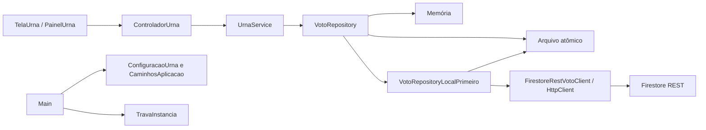
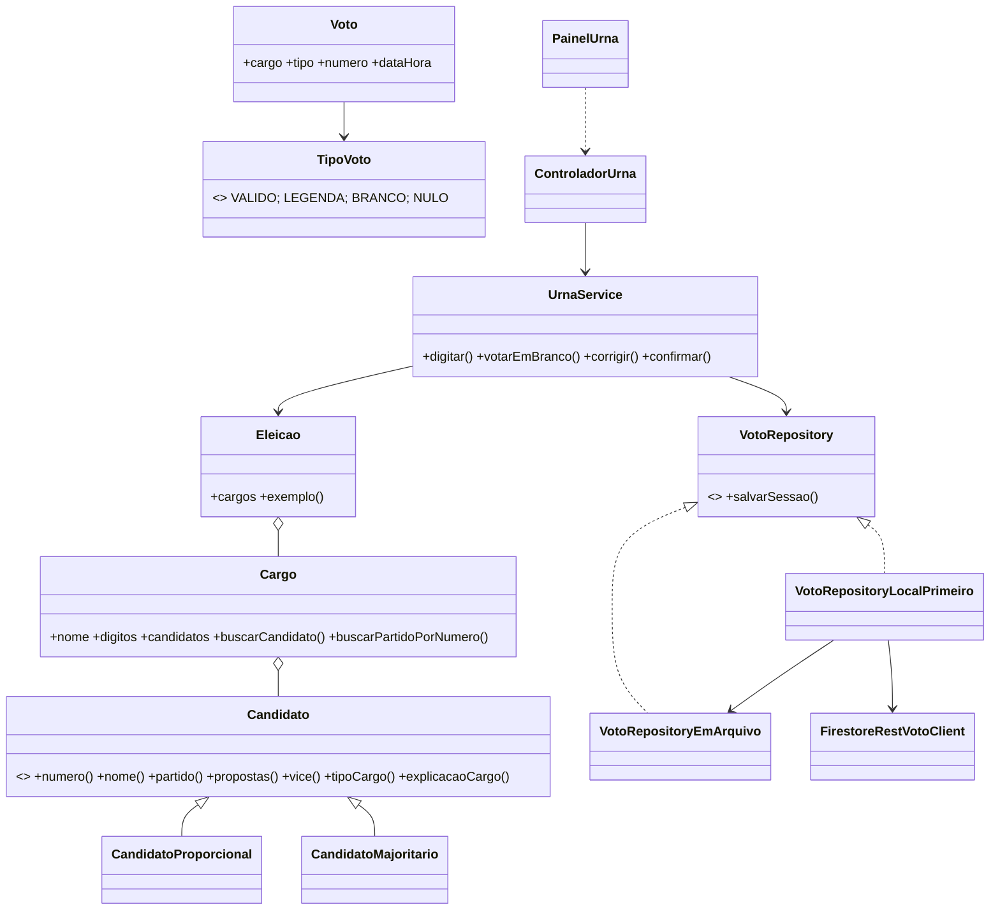

# Arquitetura e diagrama de classes

## Camadas

A interface recebe o estado do controlador; `UrnaService` valida regras e cria modelos de voto. O serviço depende apenas de `VotoRepository`, com repositórios de memória, arquivo ou local-primeiro. A implementação local-primeiro sincroniza por REST JDK sem dependência Google.

## Principais classes

| Área | Classes | Responsabilidade |
|---|---|---|
| `model` | `Candidato`, `CandidatoProporcional`, `CandidatoMajoritario`, `Cargo`, `Eleicao`, `Voto`, `TipoVoto` | Dados imutáveis e validação de candidatura/cargo |
| `service` | `UrnaService` | Sequência, entradas, branco, nulo, legenda, sessão |
| `repository` | `VotoRepository`, `VotoRepositoryEmMemoria`, `VotoRepositoryEmArquivo`, `VotoRepositoryLocalPrimeiro`, `FirestoreRestVotoClient`, `FalhaFirestore` | Persistência, fila de pendências e REST |
| `view` | `EstadoTela`, `ControladorUrna`, `PainelUrna`, `SomUrna`, `TelaUrna` | Interface Swing e eventos |
| raiz | `Main`, `ConfiguracaoUrna`, `CaminhosAplicacao`, `LogUrna`, `TravaInstancia` | Inicialização, configuração, caminhos e operação |

## POO

- **Encapsulamento:** campos de candidato e sessão são privados/imutáveis; validações ocorrem no construtor.
- **Abstração:** `Candidato` e interface `VotoRepository` definem comportamentos comuns.
- **Herança e polimorfismo:** os candidatos especializados descrevem o cargo de maneira distinta.
- **Composição:** `Eleicao` agrega cargos e `Cargo` agrega candidatos.
- **Injeção de dependência:** controlador e serviço recebem repositório pelo construtor.
- **Separação de responsabilidades:** a view mostra estados, serviço aplica regras, repositórios persistem dados.

## Decisões

O arquivo local é gravado antes de qualquer rede. O envio roda em thread daemon e usa JDK `HttpClient`. O ID de sessão é também o ID do documento remoto para que reenvios sejam idempotentes. Maven permanece como alternativa de IDE; os scripts oficiais do projeto usam apenas JDK 17+ e nenhuma biblioteca de aplicação externa.
