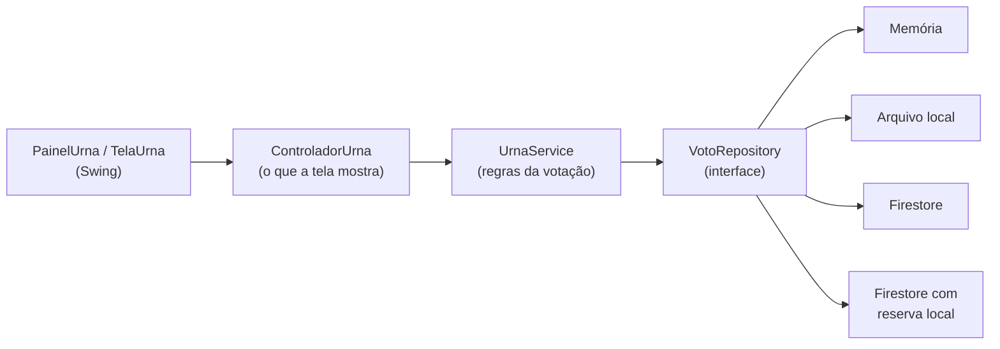
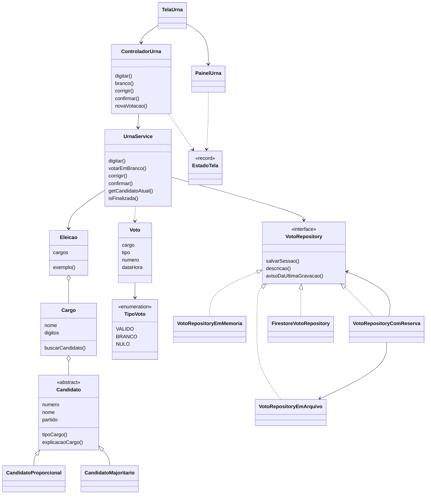

# Arquitetura e diagrama de classes

> Como o código está organizado. Relacionado a [regras-de-votacao.md](regras-de-votacao.md) e [casos-de-uso.md](casos-de-uso.md).

## Ideia central

O código é dividido em camadas. **A regra de votação não conhece a tela nem o banco de dados**, o que permite testar as regras sem abrir janela e trocar onde os votos são guardados sem mexer nelas.

## Pacotes

| Pacote | Classes | Papel |
|---|---|---|
| `model` | `Candidato` (abstrata), `CandidatoProporcional`, `CandidatoMajoritario`, `Cargo`, `Eleicao`, `Voto`, `TipoVoto` | Dados da urna, validados na criação |
| `service` | `UrnaService` | Estado e regras da votação |
| `repository` | `VotoRepository`, `VotoRepositoryEmMemoria`, `VotoRepositoryEmArquivo`, `VotoRepositoryComReserva`, `FirestoreVotoRepository`, `RepositorioException` | Onde os votos são guardados |
| `view` | `EstadoTela`, `AcoesUrna`, `ControladorUrna`, `PainelUrna`, `TelaUrna` | Interface Swing |
| raiz | `Main` | Escolhe o modo de gravação e abre a tela |

## Diagrama de classes

## Conceitos de programação orientada a objetos aplicados

| Conceito | Onde aparece |
|---|---|
| Encapsulamento | Atributos privados e validação na criação (`Candidato`, `Cargo`, `Voto`); estado interno do `UrnaService` |
| Abstração | `Candidato` (classe abstrata) e `VotoRepository` (interface) |
| Herança | `CandidatoProporcional` e `CandidatoMajoritario` estendem `Candidato` |
| Polimorfismo | `tipoCargo()` e `explicacaoCargo()` mudam conforme o tipo de candidato, e a tela usa a explicação; `VotoRepository` tem quatro implementações trocáveis |
| Composição | `Eleicao` tem `Cargo`s; `Cargo` tem `Candidato`s; `VotoRepositoryComReserva` combina dois repositórios |
| Injeção de dependência | `UrnaService` e `ControladorUrna` recebem o repositório pelo construtor |
| Tratamento de exceções | `RepositorioException` para falhas de gravação; erros de uso viram mensagens na tela |

## Decisões de projeto

| Decisão | Motivo |
|---|---|
| `ControladorUrna` separado do Swing | Permite testar o que a tela mostra sem abrir janela |
| Gravação em segundo plano | A tela não congela quando a rede está lenta |
| Gravação idempotente por sessão | Repetir a gravação não duplica votos |
| Reserva local | Falta de internet não impede o participante de terminar |
| `skipTests` no Maven | Os testes rodam por script, sem depender do Maven nem de internet |
