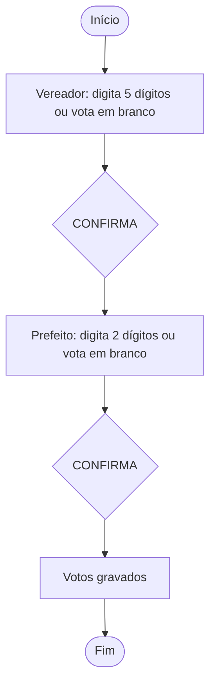

# Regras de votação

> Regras **implementadas** em `UrnaService` e mostradas pela tela. Ainda precisam ser validadas pelo grupo e pelo professor (ver [requisitos.md](requisitos.md)).

## Fluxo



## Regras

| Regra | Comportamento |
|---|---|
| Ordem dos cargos | 1º Vereador (5 dígitos), 2º Prefeito (2 dígitos) |
| Digitar | Só números; não aceita mais dígitos do que o cargo permite |
| Voto válido | Número completo que pertence a um candidato |
| Voto nulo | Número completo que **não** pertence a ninguém |
| Voto em branco | Escolha explícita; só vale se nenhum dígito foi digitado |
| Corrigir | Apaga os dígitos ou o branco do cargo atual |
| Confirmar | Exige número completo ou branco; avança para o próximo cargo |
| Gravação | Só ao confirmar o **último** cargo |
| Falha ao gravar | A votação não termina; o participante pode confirmar de novo |
| Sem internet | Com a reserva ativa, os votos ficam no computador e são enviados depois |
| Depois do fim | A urna ignora as teclas até iniciar uma nova votação |
| Anonimato | Cada voto guarda apenas cargo, tipo, número e data/hora |

## O que a tela mostra

| Situação | Título | Mensagem (cor) |
|---|---|---|
| Digitando | "Digite o número do candidato" | Orientação (azul) |
| Número completo e existente | Nome do candidato, partido e explicação do cargo | "Confira o candidato…" (verde) |
| Número completo e inexistente | "NÚMERO ERRADO / VOTO NULO" | Aviso (âmbar) |
| Voto em branco | "VOTO EM BRANCO" | Orientação (azul) |
| Erro de uso | (mantém a tela) | Explicação do erro (vermelho) |
| Fim | "VOTAÇÃO CONCLUÍDA / FIM" | Confirmação ou aviso de reserva |

## Candidatos fictícios

| Cargo | Número | Nome | Partido |
|---|---|---|---|
| Vereador | 12345 | Ana Exemplo | Partido Fictício A |
| Vereador | 23456 | Bruno Teste | Partido Fictício B |
| Vereador | 34567 | Carla Modelo | Partido Fictício C |
| Prefeito | 11 | Diego Simulado | Partido Fictício A |
| Prefeito | 22 | Elisa Educativa | Partido Fictício B |
| Prefeito | 33 | Fábio Didático | Partido Fictício C |

## Exemplos para a oficina

| O participante faz | Resultado |
|---|---|
| Digita `12345` | Mostra Ana Exemplo |
| Digita `99999` | NÚMERO ERRADO, voto nulo |
| Aperta BRANCO sem digitar | Voto em branco |
| Digita `123` e aperta CONFIRMA | Erro: falta completar o número |
| Aperta BRANCO depois de digitar | Erro: usar CORRIGE antes |

## Dados gravados

Cada votação (sessão) gera **um** registro anônimo:

```text
sessoes/{id aleatório}
  votos: [
    { cargo: "Vereador", tipo: "VALIDO", numero: "12345", dataHora: "2026-10-20T12:00:00Z" },
    { cargo: "Prefeito", tipo: "BRANCO", numero: null,    dataHora: "2026-10-20T12:00:05Z" }
  ]
```

Repetir a gravação da mesma sessão atualiza o mesmo registro, então não duplica votos.
