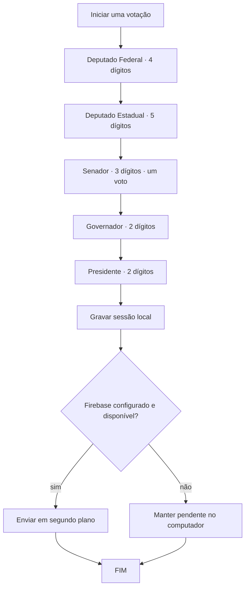

# Regras de votação

> Aplicadas por `UrnaService`; candidatos e partidos são fictícios. A simulação não é uma urna oficial.

## Uma sessão de votação



## Escolha em cada cargo

- **Válido:** número completo cadastrado.
- **Nulo:** número completo sem candidatura correspondente; a tela avisa antes da confirmação.
- **Branco:** apertar BRANCO sem digitar nenhum dígito.
- **Corrigir:** apaga o número ou desmarca branco no cargo atual.
- **Legenda:** somente nos dois cargos de Deputado. Digitar os dois dígitos do partido (81 a 85 no cargo Estadual) mostra seu nome; confirmar ali registra `LEGENDA` com o número do partido.
- **Confirmar:** aceita número completo, legenda válida nos cargos proporcionais ou branco; número incompleto não avança.
- **Persistência:** votos intermediários ficam na memória da sessão; o arquivo local recebe todos os cinco votos ao confirmar o último cargo. A interface executa essa gravação em segundo plano.
- **Fim:** exibe “FIM”. A urna não recomeça automaticamente; o mediador usa “Iniciar nova votação”.

Teclado físico: `0–9`, `B`, `Backspace`, `Enter`. O botão de áudio pode silenciar os bipes. O áudio não é necessário para votar.

## Dados de exemplo

A fonte única de candidaturas é `Eleicao.exemplo()` em `src/com/urnacidada/model/Eleicao.java`. Os dados e partidos são usados como conteúdo fictício da simulação. Altere ali e preserve os comprimentos configurados de cada cargo.

| Cargo | Número | Candidato fictício | Partido fictício |
|---|---:|---|---|
| Federal | 8101 | Ari Lume | Partido Horizonte Comunitário (fictício) |
| Federal | 8202 | Bela Nébula | Partido Raízes do Amanhã (fictício) |
| Federal | 8303 | Cael Brisa | Partido Caminhos Abertos (fictício) |
| Estadual | 81001 | Meia Bomba | Partido Horizonte Comunitário (fictício) |
| Senador | 820 | Curupira | Partido Raízes do Amanhã (fictício) |
| Senador | 830 | Peter Pardo | Partido Caminhos Abertos (fictício) |
| Senador | 833 | Ivo Pedra-Mansa | Partido Caminhos Abertos (fictício) |
| Governador | 84 | Zé Gotinha (vice Kiro Horizonte) | Partido Cuidado Coletivo (fictício) |
| Governador | 82 | Luma Cedro-Doce (vice Miro Brisa-Firme) | Partido Raízes do Amanhã (fictício) |
| Governador | 83 | Nilo Serra-Clara (vice Ona Vale-Verde) | Partido Caminhos Abertos (fictício) |
| Presidente | 81 | Pia Sol-Nascente (vice Quim Rio-Calmo) | Partido Horizonte Comunitário (fictício) |
| Presidente | 85 | Beto (vice Suri Campo-Livre) | Partido Futuro Compartilhado (fictício) |
| Presidente | 83 | Tali Nuvem-Mansa (vice Uli Trilha-Larga) | Partido Caminhos Abertos (fictício) |

Os nomes das candidaturas acima foram informados pelo usuário. **Curupira** é uma figura conhecida do folclore e **Zé Gotinha** é um mascote público conhecido; caso o professor exija nomes e personagens totalmente inéditos, troque esses dois nomes antes da apresentação. Não há imagens nem logotipos desses personagens no aplicativo.

## Documento armazenado

Cada documento `sessoes/{UUID}` contém `votos`, uma lista de cinco mapas. Cada voto inclui `cargo`, `tipo`, `numero` (nulo real no voto branco) e `dataHora` ISO-8601. O arquivo local é TSV UTF-8 e lê linhas do formato histórico já usado pelo projeto.

Exemplo apenas ilustrativo:

```text
sessoes/{uuid-aleatorio}
  votos: [
    { cargo: "Deputado Federal", tipo: "VALIDO", numero: "8101", dataHora: "2026-10-29T12:00:00Z" },
    { cargo: "Deputado Estadual", tipo: "LEGENDA", numero: "81", dataHora: "2026-10-29T12:00:01Z" },
    { cargo: "Senador", tipo: "BRANCO", numero: null, dataHora: "2026-10-29T12:00:02Z" },
    { cargo: "Governador", tipo: "NULO", numero: "99", dataHora: "2026-10-29T12:00:03Z" },
    { cargo: "Presidente", tipo: "VALIDO", numero: "82", dataHora: "2026-10-29T12:00:04Z" }
  ]
```

A sessão usa o mesmo UUID como ID do documento. O Firestore usa criação condicional; resposta “já existe” (`409`) é tratada como concluída, e a sessão local só é removida após sucesso, evitando duplicidade em reenvio.
