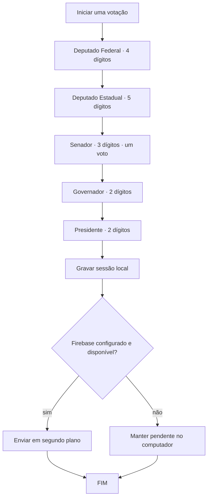

# Regras de votação

> Aplicadas por `UrnaService`; candidatos e partidos são fictícios. A simulação não é uma urna oficial.

## Uma sessão de votação



## Escolha em cada cargo

- **Válido:** número completo cadastrado.
- **Nulo:** número completo sem candidatura correspondente; a tela avisa antes da confirmação.
- **Branco:** apertar BRANCO sem digitar nenhum dígito.
- **Corrigir:** apaga o número ou desmarca branco no cargo atual.
- **Legenda:** somente nos dois cargos de Deputado. Digitar dois dígitos de partido (81, 82 ou 83) mostra seu nome; confirmar ali registra `LEGENDA` com o número do partido.
- **Confirmar:** aceita número completo, legenda válida nos cargos proporcionais ou branco; número incompleto não avança.
- **Persistência:** votos intermediários ficam na memória da sessão; o arquivo local recebe todos os cinco votos ao confirmar o último cargo. A interface executa essa gravação em segundo plano.
- **Fim:** exibe “FIM”. A urna não recomeça automaticamente; o mediador usa “Iniciar nova votação”.

Teclado físico: `0–9`, `B`, `Backspace`, `Enter`. O botão de áudio pode silenciar os bipes. O áudio não é necessário para votar.

## Dados de exemplo

A fonte única de candidaturas é `Eleicao.exemplo()` em `src/com/urnacidada/model/Eleicao.java`. Códigos de partido 81–83, nomes, vices e propostas são inventados e neutros. Altere ali e preserve os comprimentos configurados de cada cargo.

| Cargo | Número | Candidato fictício | Partido fictício |
|---|---:|---|---|
| Federal | 8101 | Ari Lume | Partido Horizonte Fictício |
| Federal | 8202 | Bela Nébula | Rede Aurora Fictícia |
| Federal | 8303 | Cael Brisa | Movimento Caminhos Fictício |
| Estadual | 81001 | Dora Vale-Luz | Partido Horizonte Fictício |
| Estadual | 82002 | Eno Maré-Clara | Rede Aurora Fictícia |
| Estadual | 83003 | Fira Campo-Azul | Movimento Caminhos Fictício |
| Senador | 811 | Galo Riacho | Partido Horizonte Fictício |
| Senador | 822 | Hera Pôr-do-Sol | Rede Aurora Fictícia |
| Senador | 833 | Ivo Pedra-Mansa | Movimento Caminhos Fictício |
| Governador | 81 | Jaci Nascente (vice Kiro Horizonte) | Partido Horizonte Fictício |
| Governador | 82 | Luma Cedro-Doce (vice Miro Brisa-Firme) | Rede Aurora Fictícia |
| Governador | 83 | Nilo Serra-Clara (vice Ona Vale-Verde) | Movimento Caminhos Fictício |
| Presidente | 81 | Pia Sol-Nascente (vice Quim Rio-Calmo) | Partido Horizonte Fictício |
| Presidente | 82 | Ravi Lago-Azul (vice Suri Campo-Livre) | Rede Aurora Fictícia |
| Presidente | 83 | Tali Nuvem-Mansa (vice Uli Trilha-Larga) | Movimento Caminhos Fictício |

## Documento armazenado

Cada documento `sessoes/{UUID}` contém `votos`, uma lista de cinco mapas. Cada voto inclui `cargo`, `tipo`, `numero` (nulo real no voto branco) e `dataHora` ISO-8601. O arquivo local é TSV UTF-8 e lê linhas do formato histórico já usado pelo projeto.

Exemplo apenas ilustrativo:

```text
sessoes/{uuid-aleatorio}
  votos: [
    { cargo: "Deputado Federal", tipo: "VALIDO", numero: "8101", dataHora: "2026-10-29T12:00:00Z" },
    { cargo: "Deputado Estadual", tipo: "LEGENDA", numero: "81", dataHora: "2026-10-29T12:00:01Z" },
    { cargo: "Senador", tipo: "BRANCO", numero: null, dataHora: "2026-10-29T12:00:02Z" },
    { cargo: "Governador", tipo: "NULO", numero: "99", dataHora: "2026-10-29T12:00:03Z" },
    { cargo: "Presidente", tipo: "VALIDO", numero: "82", dataHora: "2026-10-29T12:00:04Z" }
  ]
```

A sessão usa o mesmo UUID como ID do documento. O Firestore usa criação condicional; resposta “já existe” (`409`) é tratada como concluída, e a sessão local só é removida após sucesso, evitando duplicidade em reenvio.
